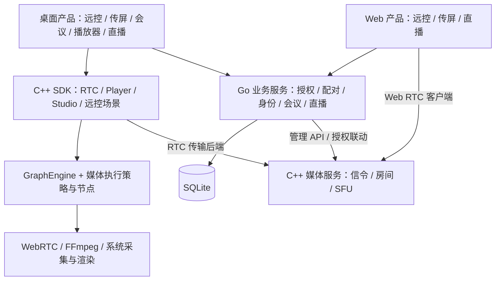

# 当前架构梳理与优化建议

审查日期：2026-10-30（Asia/Shanghai）。依据当前源码、构建配置及实现文档；性能风险来自代码路径分析，尚未通过容量或设备测试量化。

本文保留本次 RTC 引擎解耦之前的审查快照。后续已实施的变更见 [RTC 引擎解耦说明](../../livekit-sdk-cpp/docs/rtc-engine-decoupling-20261030.md)，当前类关系见 [SDK 类图](sdk-class-diagrams/README.md)。

## 1. 总体判断

平台已经形成多产品客户端、场景 SDK、媒体服务、业务服务的分工。RTC、Player、Studio 都已使用 GraphEngine，RTC 普通 API 与高级图 API 已分离，公共 CPU 帧视图、共享采集、有界队列、音频 NetEq/APM 和同步时钟也已有实现。

下一步应保留这些边界，优先缩短锁内工作、隔离音视频调度、减少 GPU/CPU 往返，并补齐跨引擎资源及构建契约。现阶段没有证据支持重写全套引擎或立即拆分业务微服务。

## 2. 当前架构

图中的 GraphEngine 属于 SDK 媒体组织层，并不表示 SFU 转发通过 GraphEngine 执行；纯编码 RTC 也可只使用后端能力。

| 模块 | 当前职责与边界 |
| --- | --- |
| `livekit-app` | 按产品、终端组织；桌面有 Qt 和 ImGui/SDL，Web 使用 TypeScript/Vite。应用维护 UI、业务 API 接入、工作线程和会话编排。 |
| `livekit-sdk-cpp` | RTC 管理房间与每轨媒体图；Player 管理播放状态及 FFmpeg 图；Studio 管理素材、混音、合成、录制，并通过媒体源衔接 RTC。 |
| `graphflow-cpp` | 通用拓扑、生命周期和事件；媒体时钟、缓冲、编解码仍由 SDK 提供。 |
| `webrtc` | 原生传输、RTP/RTCP、编解码及音频处理底座，被 SDK 和 C++ 媒体服务复用。 |
| `livekit-cpp` | 独立媒体进程，Asio 管理信令和房间，WebRTC 线程处理媒体。当前仍是单机实现，完整 Go LiveKit 替代尚未完成。 |
| `livekit-server` | Go 模块化单体，SQLite 存储；远控、传屏已有 application/domain/infrastructure 分层，会议和直播集中在各自 service/http 文件中；后两者按配置启用。 |

关键执行模型：

- **RTC**：同步 `Result` 控制 API，在应用工作线程执行；每个房间通过 operation mutex 串行化控制。媒体源、编解码、输出使用独立 worker；通知和应用媒体回调另有队列。每轨 GraphEngine 共用一个 RoomEngine。
- **Player**：独立 `AsyncResult` API，Player worker 驱动 `PlaybackGraph` / `MediaExecutor`，按播放时钟和背压推进。
- **Studio**：一个 worker 每 2 ms 调用 `graph.step()`；图内同步事件传递，10 ms 音频与视频时钟共用该序列；采集和录制另有 worker。
- **SFU**：主线程调用一次 `io.run()`，全局房间状态在该事件循环上修改；WebRTC network/worker/signaling 线程承担媒体工作，部分控制接口使用 `BlockingCall` 跨线程交互。

## 3. 优化项及优先级

P1 表示建议下一轮优先处理，P2 表示有明确场景或容量需求后推进；不等同于已确认生产事故。

### P1：将业务服务的外部 I/O 移出全局锁和数据库事务

**依据**：`livekit-server/internal/businesses/conference/service.go:606` 的 `Sweep` 全程持有 `s.mu`，遍历会议并调用 Participants/Delete/Remove/Mute 等远端方法。`livestudio/service.go:174` 的 `transact` 在加锁后注册 `defer s.drainMedia(ctx)`，按 Go defer 顺序，媒体清理在解锁前执行；清理整体超时为 3 秒。此外部分直播媒体查询发生在事务回调中。

**影响**：一个房间的媒体服务慢请求可以阻塞同一业务模块其他房间的读写和授权查询。直播媒体查询若占用写事务，还会增加同一 SQLite 文件的写等待。现有超时、重试和持久清理记录能限制或恢复失败，但不能消除等待扩散。

**建议**：复用已有 Jobs / `live_media_cleanup`，采用“短事务写入意图 → 有界后台执行 → 校验版本并回写结果”；以会议/直播间为单位串行化，网络调用不持有模块全局锁。撤权仍应先更新业务授权状态，不能为了异步执行削弱入房校验。

会议 `List` 当前全表读取 JSON 后筛选用户，`Sweep` 扫描全部会议；后续可把 owner/state/member 关系和任务状态建立可索引投影，并加分页、任务退避和历史保留策略。SQLite 可以继续作为单机存储，不必先换数据库。

**验收**：注入一个房间的慢媒体调用，其他房间仍可查询/入房；重启后任务恢复，重复执行和过期结果不恢复旧授权；观察锁等待、事务时长和任务积压。

### P1：隔离 Studio 音频时钟与视频、录制控制工作

**依据**：`livekit-sdk-cpp/src/engines/studio/studio.cpp:77` 以 2 ms sleep 驱动整图；`studio_graph.hpp:24` 明确音视频共用 owner sequence。`studio_graph.cpp` 的 ClockNode 有最多十次音频补偿和过期重定位；RecorderNode 的结束动作调用 `recorder_->finish()`。

**影响**：慢合成、素材初始化或录制收尾会延迟音频调度。已有补偿和有界队列避免无限积压，但不能保证音频准时。

**建议**：继续由 GraphEngine 管理图与生命周期，将音频混音/输出和视频合成分配给独立执行序列，通过有界帧句柄队列交接；录制收尾异步完成。以截止时间或数据就绪唤醒替换固定 2 ms 轮询，并保留 GPU 上下文归属和统一关闭屏障。

**验收**：人为拖慢合成或录制收尾，测量 10 ms 音频输出间隔、欠载次数、视频帧龄和关闭耗时，验证故障不会阻塞另一分支。

### P1：减少 Studio 逐帧分配、同步读回和格式往返

**依据**：Windows `compositor.cpp:181` 在逐层循环创建纹理/SRV，`:211` 复制输出并 `Map` 读回；屏幕采集 `capture_windows.cpp:136` 也创建 staging 纹理并读回。macOS `compositor_macos.mm:82` 每层分配 buffer，`:107` 同步等待 GPU。合成输出是 CPU RGBA，`studio_graph.cpp:616` 再转 I420 供 RTC 发布。

**影响**：多图层、高分辨率和高帧率时存在额外资源分配、内存带宽及 CPU/GPU 同步成本。代码确认这些操作存在，实际占比尚需 profiling。

**建议**：先按素材与尺寸缓存纹理/SRV/buffer，静态图片和文字仅在变化时上传；用多缓冲与显式同步减少阻塞读回。再扩展独立 GPU surface 契约，描述设备、格式、生命周期和 fence，让合成、预览、硬件编码共享兼容资源。保留 CPU 回退；当前 `media::FrameView` 是 CPU spans，不能直接装入纹理句柄冒充兼容。

**验收**：固定素材与分辨率，比较资源创建次数、每帧复制字节、GPU 等待时间、P95 合成耗时和录制/发布画面正确性。

### P1：恢复可重复构建门禁，明确当前版本证据

本次实际运行 backend-only Release 构建，`async_result_tests.cpp:7` 的 `std::chrono_literals` 和 `:24` 的 `0ms` 在 MSVC 14.44 下编译失败。测试未显式包含 `<chrono>`，当前 include 链未提供字面量声明。构建整体退出码为 1。

建议先补齐直接使用的标准库头依赖，再将 backend-only、Player-only、RTC media、Studio 和外部 consumer 纳入统一自动化入口。已存在普通引擎头独立编译检查，应保留并扩展；不能仅沿用旧文档中通过的数量。

SDK 当前主要通过源码 `add_subdirectory` 集成，App 的 `NativeSDK.cmake` 还使用 `CACHE FORCE` 与 SDK support include 路径。若要作为独立 SDK 分发，应补齐组件化安装/导出与外部消费验证；开发阶段仍可保留源码集成。不要把多平台配置文件当成多平台验证证据。

### P2：跨 RTC、Player、Studio 共享物理设备和音频参考

**依据**：`src/engines/rtc/media_engine.cpp:371` 默认每个媒体引擎创建自己的 AudioRenderReference / AudioOutputSession；Studio 使用独立 AudioCapture/Monitor；当前架构文档明确没有全局设备管理器。`SharedMediaInput` 已实现跨房间共享采集，这是可复用的基础。

**建议**：增加可注入、显式作用域的 MediaRuntime / DeviceSession，管理设备租约、输出混音、实际播放参考、热插拔和资源预算。优先覆盖同一应用多房间、会议与直播共存场景；无需强制进程全局单例。AEC 应读取统一输出的实际混音参考，不能给每个发布分支重复处理。

**验收**：多个引擎共享设备、关闭单个消费者不影响其他消费者；合成测试验证引用和 AEC 生命周期，实际声学回声另做设备验收。

### P2：为 RTC 故障资源回收和关闭等待建立可观测契约

**依据**：`src/engines/rtc/rtc_engine_impl.hpp:20` 在下一次控制调用时执行 `reap_failed()`；`pipeline_engine.cpp:45` 才摘除并关闭失败图。`application_output.hpp:35` 的 quiesce 会 join 正在执行的回调。operation mutex 的等待不计入随后开始的协议超时，close 等待前序操作而非取消它们。

**影响**：错误可立即通知，但没有后续控制调用时，图级资源的最终回收可能延后；不返回的应用回调会阻塞关闭。这是当前明确的生命周期契约，不能直接判定为死锁或泄漏。

**建议**：保留同步 RTC API，先在应用公共会话执行器中处理终态清理，记录控制排队、协议等待、回调耗时和回收延迟。若要求 SDK 自动回收，再设计专用的安全回收路径，与现有 operation mutex 协调，不能在媒体回调上直接 stop/join，也不能用强杀线程替代所有权管理。

**验收**：故障后无业务交互的资源归还、慢回调告警、离会重入、旧 epoch 回调隔离，以及关闭等待上限的产品约定。

### P2：统一媒体连接与指标契约，保留不同执行策略

**依据**：RTC 使用带帧数/字节/帧龄限制的 RawFrameQueue 和应用输出 dispatcher；Player 使用 MediaChannel、MediaDelivery 确认及 MediaExecutor；Studio 使用自己的类型事件和队列。共同 FrameView 已存在，但三个执行模型不是一个完整统一的媒体运行时。

**建议**：先统一 QueueLimits、格式/存储描述、epoch/discontinuity、EOS/flush、失败关联及指标名称。按分支报告 admitted/delivered/dropped、queue bytes、oldest age、处理耗时和丢弃原因。实时视频允许丢旧帧，播放/离线采用背压，音频保留连续性语义；无需把所有场景强行改成相同线程或队列实现。

**验收**：不同场景复用契约测试，分支过载互不影响，Seek/重连时不混入旧代次帧；端到端指标能定位等待发生在哪个节点。

### P2：SFU 先测量控制面阻塞，再推进房间分片

**依据**：`livekit-cpp/src/app/main.cpp:96` 创建单个 io_context 并在 `:111` 调用一次 run；`rtc.cpp:88` 创建共享 WebRTC 线程；`sfu.cpp` 中多个控制方法使用跨线程 BlockingCall。媒体本身并不都在主事件循环上执行。

**建议**：先记录事件循环延迟、跨线程等待、房间操作耗时、订阅数及 pacer/丢帧指标，做多房间、订阅抖动与弱网的容量测试。确认瓶颈后按房间设置串行执行边界，逐步将阻塞交互变为请求/完成回调；不能直接增加 io.run 线程数而不处理当前房间状态的串行假设。

Redis/集群路由、drain、外部 worker 属于另一层能力，应沿 `livekit-cpp/docs/GO_REPLACEMENT.md` 分阶段推进。已有单机兼容测试不能代表完整替代或生产容量验收。

## 4. 文档应同步收敛

- `livekit-server/README.md:5` 仍称账号、会议未实现，但 identity/conference 源码和 bootstrap 开关已经存在。
- 聚合 `docs/architecture/sdk-architecture.md:196` 仍描述 `next_event()`，而当前 SDK 文档与实现使用回调及同步 Result。
- `docs/architecture/repository-layout.md:78` 仍使用旧 `LIVEKIT_BUILD_RTC`，当前 CMake 已拆为 NATIVE / GRAPH_NODES / MEDIA。

建议让聚合文档只维护跨仓库边界、能力状态及指向当前实现文档的入口；历史实施记录标明适用提交。维护一份区分“已实现 / 自动化已验证 / 实际设备已验收”的能力表。

## 5. 推荐落地顺序

1. 修复编译门禁和过期入口，建立可复现的当前基线。
2. 移出业务全局锁内的媒体调用，复用持久任务机制。
3. 优化 Studio 调度隔离及资源缓存，先测量再推进 GPU surface 链路。
4. 按多房间/直播实际需求建立设备共享、媒体契约和故障回收指标。
5. 基于容量数据推进 SFU 房间分片、集群与外部 worker。

## 6. 本次验证范围

- 已执行：`cmake --build livekit-sdk-cpp/out/rtc-backend-contracts --config Release --parallel 4`。整体失败；原因见上文 async_result 测试编译错误。普通公共引擎头、Result、RTC backend/pipeline 相关目标完成编译。
- 对本次成功重建的目标执行：`ctest --test-dir livekit-sdk-cpp/out/rtc-backend-contracts -C Release -R '^(result|rtc_backend|rtc_pipelines)$' --output-on-failure`，3/3 通过。
- 没有运行完整平台测试、Go/Web 测试、真实 SFU 集成、容量压测或设备人工验收；性能结论是待测量的优化机会。
- 本次仅新增审查文档，未修改业务实现；没有操作用户桌面。
