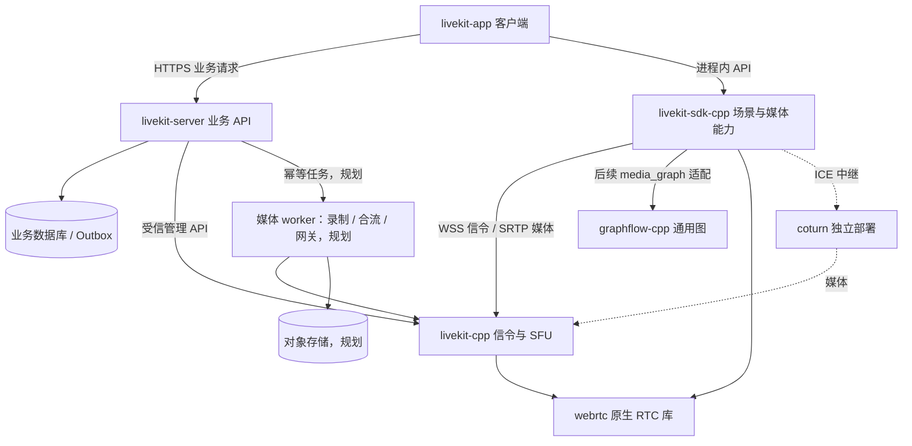
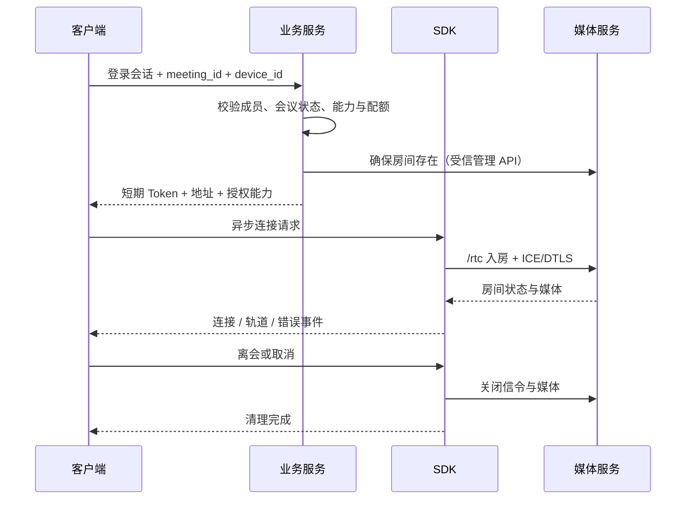

# AV Platform 总体设计

版本：v0.1；日期：2026-10-26；状态：设计草案。

本文定义平台职责、跨仓库契约、部署与演进路线。文中的“目标”“建议”“拟定”均不代表已有实现。现有 RTC 能力和失败记录以 [RTC 交接快照](../integration/rtc/STATUS_AND_HANDOFF.md)及各仓库验证记录为准，本次文档编写不构成重新验收。

## 1. 产品目标与范围

平台覆盖传屏、视频会议、远程控制、播放器和剪辑，复用原生媒体能力，同时将账号、授权和任务管理集中到业务服务。第一阶段以 Windows 原生桌面闭环为集成目标；Linux 媒体服务先解决跨系统互通。移动端与 Web 按能力逐项扩展，不承诺与桌面功能一致。

首个产品闭环：用户登录 → 创建或加入会议 → 获取限定权限的 Token → 发布/订阅音视频 → 显示成员与连接状态 → 离会和释放资源。屏幕采集、设备选择等尚缺的 SDK 能力单独验收，不能由现有会议 Demo 推导为已经交付。

首期不包含多地域调度、无缝故障迁移、完整剪辑器、第三方节点市场及计费结算。账号、项目、审计等设计保留扩展空间，优先实现闭环所需子集。

## 2. 仓库地图与现状

| 仓库 | 职责 | 当前基线 | 设计入口 |
| --- | --- | --- | --- |
| `av-platform` | 总体契约、集成文档、固定依赖版本 | 聚合仓库，无统一产品构建 | 本文 |
| `livekit-app` | 产品 UI、交互、系统授权引导 | `f911afa`，ImGui 远控被控端与浏览器控制端 | [客户端设计](../../livekit-app/docs/design.md) |
| `livekit-server` | 账号、项目、设备、业务权限、Token、任务与资产 | `97c2c40`，Go + SQLite 远控授权服务 | [业务服务设计](../../livekit-server/docs/design.md) |
| `livekit-sdk-cpp` | 原生 SDK、场景引擎与媒体运行时的演进载体 | `2cfd118`，现有 C++20 RTC SDK | [SDK 仓库设计](../../livekit-sdk-cpp/docs/design.md) |
| `livekit-cpp` | RTC 信令、RoomService、SFU、未来媒体 worker | `da4732d`，C++20 单机兼容服务 | [媒体服务设计](../../livekit-cpp/docs/design.md) |
| `graphflow-cpp` | 通用图、生命周期、控制事件 | `4b0c881`，C++17 Core/Engine | [GraphFlow 设计](../../graphflow-cpp/docs/design.md) |
| `webrtc` | 原生 RTC 协议、编解码、拥塞控制、设备基础 | `40200b3d88`，M137 衍生版本 | [WebRTC 集成设计](../../webrtc/docs/av-platform-design.md) |

以上提交号为文档记录的基线，不是新增发布版本；实际固定版本以主仓库的 gitlink 为准。`graphflow-cpp`、`livekit-sdk-cpp`、`livekit-cpp`、`webrtc`、`livekit-app`、`livekit-server` 均已在 `.gitmodules` 登记，递归克隆聚合仓库会取得这些子模块。

`graphflow-cpp/utoolkit` 属于 GraphFlow 的传递依赖，其他 vendored 第三方库也由直接使用方管理；本次不重写其上游设计。

## 3. 架构与依赖方向

目录实施以 [多业务仓库结构](repository-layout.md) 为准：客户端按 APP/端组织，业务服务按业务领域拆模块。当前远控已有完整最小闭环；下文账号、会议、任务等描述仍为目标设计。

图中的 GraphFlow 接入及 worker 链路是目标架构。当前 SDK 已有首版媒体图；业务 API 与 SQLite 已实现远控子集，账号、会议及任务系统仍待实现。实际媒体数据在客户端 SDK、SFU、TURN 和 worker 之间传送，不经过业务 API 进程。

依赖规则：

- 客户端调用 SDK 公共头文件和业务 HTTP API，不直接引用 WebRTC、GraphFlow 或媒体服务内部类。
- SDK 持有媒体对象与场景状态；GraphFlow 保持领域无关，媒体端口、时钟、背压由 SDK 扩展。
- 媒体服务执行 Token 权限和媒体路由；业务服务拥有用户身份、成员关系、控制授权及任务记录。
- 业务服务通过管理 API 访问媒体服务，不通过数据库修改媒体进程状态，也不代理每个媒体包。
- RTP/RTCP、重传、拥塞控制和 pacing 继续复用 libwebrtc；应用层只实现预算、权限与路由策略。

## 4. 技术选择与模块落点

| 层 | 本版设计选择 | 状态与理由 |
| --- | --- | --- |
| 客户端 | 建议 Qt 6 / QML + C++ 适配层 | 待原型验证；便于接入原生 SDK，复用跨平台 UI；发布前确认 Qt 许可与打包方式 |
| 业务服务 | 建议 Go + PostgreSQL，HTTP JSON API | 待定案；使用成熟服务端 SDK/HTTP 客户端对接媒体管理，不链接 C++ 媒体库 |
| SDK / 媒体服务 | 继续 C++20 | 既有实现；避免为了拆仓库重写 RTC |
| 通用图 | 继续 C++17 GraphFlow | 既有实现；上层 C++20 可消费，构建时统一 CRT |
| 媒体后端 | 固定 WebRTC；FFmpeg 按功能引入 | WebRTC 已接入；文件输入现有 FFmpeg 路径不等于完整播放/剪辑后端 |
| 任务与存储 | 初期数据库任务表 + Outbox；对象存储接口 | 规划；没有规模证据前不强制引入消息集群或 Redis |

客户端与业务服务的技术栈是本版推荐方案，不视为用户已确定的实现约束。它们可独立调整，但不得改变下文权限、生命周期和协议契约。统一媒体模块暂在 `livekit-sdk-cpp` 内分层演进，有独立发布需求后再拆仓库。

## 5. 领域模型与状态所有权

| 对象 | 权威状态所在 | 关键约束 |
| --- | --- | --- |
| User / Project / Membership | 业务数据库 | 每次资源操作重新检查项目成员关系与角色 |
| Device | 业务数据库 + 客户端在线状态 | 设备归属不等于允许远控，在线状态有过期时间 |
| Meeting | 业务数据库 | 产品会议 ID 与媒体房间名分别保存；结束后不再签发入房 Token |
| Participant / Track | 媒体服务实时状态 | 业务缓存只作展示，不能伪装为当前在线事实 |
| LocalSession / MediaGraph | SDK 实例 | 同一会话代次隔离旧请求、句柄、帧与回调 |
| ControlGrant | 业务授权 + 被控端执行状态 | 必须同时满足有效授权与本地同意，撤销后停止注入 |
| MediaJob / Asset | 业务数据库；worker 回报执行事实 | 任务提交成功不等于媒体文件可用 |

所有业务对象使用稳定 ID；原生房间/轨道 SID 是外部引用，不作为业务数据库主键。项目 ID 从认证上下文与资源归属共同确认，不能仅信任客户端提交值。

媒体房间名建议由服务端生成 `p_<projectId>_m_<meetingId>`，参与者 identity 关联用户、设备和连接实例，避免同账号多设备意外互踢。命名只减少冲突，不提供租户隔离；当前媒体服务尚无完整项目级管理隔离，首期媒体管理入口只允许受信业务服务访问，需要强隔离时使用独立实例和密钥。

## 6. 跨仓库接口契约

### 6.1 业务 HTTP API（拟定）

统一 `/api/v1` 前缀，JSON 使用 snake_case，时间使用 UTC RFC3339，客户端本地化展示。认证入口与令牌刷新单独设计；除健康检查和认证必要入口外，业务资源接口要求应用会话认证。

| 接口 | 输入与输出重点 | 所有者 |
| --- | --- | --- |
| `POST /api/v1/meetings` | 项目、标题、访问策略 → meeting_id、业务状态 | 业务服务 |
| `POST /api/v1/meetings/{id}/join` | device_id、请求能力 → media_url、media_token、expires_at、participant_identity、granted_capabilities | 业务服务 |
| `POST /api/v1/meetings/{id}/end` | 幂等结束请求 → 业务结束状态、媒体清理状态 | 业务服务 |
| `POST /api/v1/control-grants` | 目标设备、会话、请求能力 → pending 授权 | 业务服务 |
| `POST /api/v1/control-grants/{id}/approve` | 被控设备认证与本地同意凭据 → 限时授权 | 业务服务 |
| `POST /api/v1/control-grants/{id}/revoke` | 撤销原因 → 权威撤销状态 | 业务服务 |
| `POST /api/v1/media-jobs` | job_type、资源引用、参数 → job_id、queued 状态 | 业务服务，后续阶段 |
| `GET /api/v1/media-jobs/{id}` | → 状态、进度、产物引用或结构化错误 | 业务服务，后续阶段 |

请求能力只是申请，响应权限取成员角色、会议策略、设备与后端支持的交集。API key/secret 永不返回给客户端。应用登录 Token 与媒体入房 Token 使用不同用途和验证边界，互不替代。

错误包络拟定为 `error.code/message/retryable/details` 和 `request_id`；401 表示认证失效，403 表示无权访问，409 表示状态冲突，429 表示限流。客户端根据稳定 code 分支，message 用于展示，不解析文案。创建会议、结束会议和提交任务使用 `Idempotency-Key`；同主体、接口、键重复请求返回同一结果，键相同而请求内容不同返回冲突。

### 6.2 SDK 与媒体协议

当前 SDK 以 `LiveKit::SDK` 和 `include/livekit/` 为入口；目标场景接口见 [SDK 架构设计](sdk-architecture.md)。当前媒体服务采用 `/rtc` 双 PeerConnection 和固定 LiveKit protobuf 兼容范围，不能直接启用 `/rtc/v1`。业务服务只调用已验收的 RoomService 子集，其余管理能力须先完成服务端实现和契约测试。

### 6.3 事件与任务（目标）

业务事件包含 `event_id`、`event_type`、`schema_version`、`project_id`、`aggregate_id`、`aggregate_version`、`occurred_at`、`payload`；按至少一次投递设计，消费者按 event_id 去重，按对象版本处理过期事件。事件不携带密钥或完整 Token。

业务事务提交资源变化和 Outbox 记录；投递与外部调用允许重试。当前媒体服务没有 Webhook，首期用受信管理 API 定期对账，不能假定可靠媒体事件源已存在。未来 Webhook 必须校验签名、时间窗口与事件 ID。

## 7. 关键流程

### 7.1 入会与离会

房间创建可能超时但实际成功，应以同一媒体房间名查询确认，避免生成重复房间。业务会议提交与媒体创建不做跨服务数据库事务；使用 preparing/active/failed 等状态和补偿记录恢复。

断线时 UI 进入 reconnecting；目标重试策略为有上限的退避、重新检查业务授权、必要时获取新 Token，再完整入房。当前 SDK 不提供自动无缝恢复，该策略需要在场景层实现。用户主动离会后禁止自动重连，旧代次事件不得把 UI 重新置为已连接。

### 7.2 远程控制

控制方发起请求 → 被控端展示目标、范围与期限 → 本地用户同意 → 业务服务签发限定控制授权 → 被控端校验授权、会话代次及控制者身份 → SDK 执行系统输入。

媒体 Token 的数据发送权限不等于输入注入权限。控制消息带控制授权 ID、代次、单调序号与显示布局版本；关键按键使用可靠有序通道，鼠标移动允许合并。撤权、断线、授权过期或本地用户终止时，先停止输入并释放按键，再上报状态。通知中断时由短期租约到期兜底；不能仅依赖推送实现撤权。

### 7.3 媒体任务

业务服务创建幂等任务并检查配额 → 调度到媒体 worker → worker 持租约执行 → 上传临时产物并校验 → 提交产物清单 → 业务服务将资产置为 available。任务状态包含 queued/running/cancel_requested/succeeded/failed/cancelled；进度可更新，终态不可被迟到回报覆盖。

worker 使用 attempt 和 fencing token 区分重试实例，过期 worker 不得提交新结果。取消需执行端确认；超时不假装取消成功。业务服务拥有任务策略，`livekit-cpp` 后续 worker 拥有媒体执行，两者不重复维护调度权威。

## 8. 安全与资源边界

业务端执行成员、角色、项目、设备归属与配额校验；媒体端执行房间和轨道授权；被控端执行本地同意与输入权限。任何一层拒绝均不能通过 UI 开关绕过。暂不支持的限制应拒绝请求，不返回看似受限但实际权限更大的 Token。

短期 Token 过期通常限制后续认证，不应假定它会立即断开已建立媒体会话。封禁或结束会议需要撤销后续签发资格，并执行移除参与者或删除房间及重试对账。当前媒体密钥即时轮换、细粒度 ACL 和多项目隔离尚未完整实现。

媒体队列、控制队列、任务并发、单项目配额分别限制。音频回调不能阻塞于磁盘、数据库或 UI。日志脱敏 Token、密钥和用户内容；审计记录授权、撤销、任务与管理操作，保留期限由部署策略确定。

## 9. 部署、观测与发布

开发环境按业务 API、数据库、媒体服务、coturn 分进程运行。业务服务进程/镜像建议名为 `livekit-business-api`；媒体服务当前可执行文件仍叫 `livekit-server`，运维显示名用 `livekit-media`，避免与业务仓库同名混淆。

首期生产候选为单区域、单 SFU 实例、独立数据库；控制面服务可在无状态化后横向扩容。媒体房间固定到实例，实例故障暂按完整重连处理，不承诺跨节点续接。公网需要 HTTPS/WSS、可达 ICE 端口和经验证的 TURN，不能把本机 TURN 成功当作公网验收。

业务日志贯穿 request_id、project_id、meeting_id、job_id；SDK 与媒体侧关联 session_id、participant identity、track SID 和会话代次。指标标签禁止直接使用无界用户/会话 ID。监控入房成功率、首帧、重连、队列、丢帧、CPU/内存、出口、任务租约与失败率；已有 metrics 不等于完整告警系统。

发布记录应固定六仓库提交、WebRTC 补丁、协议版本、编译器/CRT、依赖与产物哈希。新二进制先通过独立消费者构建、真实媒体互通和关闭回收验证，再更新聚合仓库 gitlink。

数据库采用版本化迁移、先兼容新增后清理旧结构；备份恢复需要演练。媒体服务滚动升级/drain 尚待实现，首期升级明确会话中断窗口和完整重连策略。

## 10. 实施阶段与验收

| 阶段 | 主要交付 | 退出条件 |
| --- | --- | --- |
| P0 基线稳定 | 关闭文件四轨与跨系统失败，锁定协议/工具链 | 不降低原断言；原生、浏览器、CLI 证据可复现 |
| P1 产品最小闭环 | 客户端、账号/会议/Token API、RTC 接入、退出清理 | 双用户真实音视频；越权、过期 Token、取消与重连测试通过 |
| P2 媒体运行时 | media_core/media_graph、设备、屏幕源、分支录制 | 一路采集预览/传输；慢消费者隔离；停止与排空正确 |
| P3 场景扩展 | 远控、播放器、剪辑最小功能 | 撤权释放输入；Seek 无旧帧；预览/导出时间线一致 |
| P4 服务端任务 | RU 录制、MCU、直播网关、资产与任务恢复 | 真实输出、租约故障恢复、取消、幂等与 AV 同步 |
| P5 规模化 | 多节点、移动端/其他桌面端、安装交付 | 容量、长稳、跨网络、升级与恢复演练 |

本表是平台交付阶段，不替代既有 [RTC 实施规划](../integration/rtc/IMPLEMENTATION.md)的 P0–P3 编号。移动端、运维等可独立推进，但不得用后续功能掩盖基线失败。

沿用原 RTC 整体验收目标：正常网络入房成功率 ≥99.5%，远端首帧 P95 ≤2 s，采集到播放 P95 ≤300 ms，连通恢复后媒体恢复 P95 ≤10 s；100 并发真实媒体会话与 24 h 稳定性；媒体 worker 两小时 AV 偏差 ≤100 ms。这些目标尚未完成验收。测试计划需明确硬件、分辨率、人数、网络损伤、样本量及统计口径，单次成功不能替代 P95。

## 11. 待定决策与文档维护

客户端框架与业务语言在原型阶段确认；设备/系统版本矩阵、首个传屏负载、数据库部署形态、数据留存、Qt/FFmpeg 分发许可和容量预算在对应功能开工前记录决策。未确认项不阻止职责和协议契约先行。

总体职责由本文维护；SDK 媒体机制由 [SDK 架构设计](sdk-architecture.md)维护；各仓库实现落点由其设计文档维护；实测状态由各自 VALIDATION/交接记录维护。修改跨仓库接口时同步更新双方文档与契约测试。链接使用相邻仓库布局，单独克隆某仓库时需结合聚合工作区阅读跨仓库引用。
