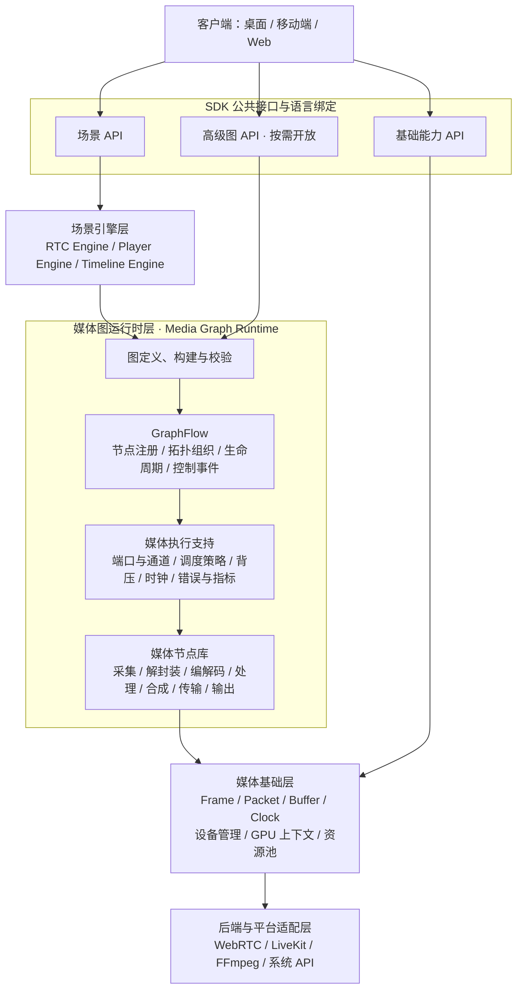

# SDK 架构设计

状态：设计草案 v0.2。初稿日期：2026-10-25；现状校正与文档关联更新：2026-10-26。

本文记录当前讨论确定的架构方向。除“现有模块”部分明确列出的能力外，模块名、接口名和执行策略均为设计目标，示意代码不代表已有可调用 API。

平台职责和跨仓库接口见 [总体设计](platform-design.md)，SDK 当前源码结构和迁移步骤见 [SDK 仓库设计](../../livekit-sdk-cpp/docs/design.md)。当前媒体状态以 [RTC 交接快照](../integration/rtc/STATUS_AND_HANDOFF.md)为准，本次文档更新未重新执行测试。

## 1. 目标与范围

SDK 提供传屏、视频会议、远程控制、播放器和剪辑能力，采用“统一媒体底座 + 独立场景引擎 + 媒体图运行时 + 可替换后端”的架构。

初期按原生桌面优先设计，后续扩展移动端和 Web；具体平台支持范围仍需确认并逐项验证。本文的“传屏”指设备之间实时传输屏幕画面及可用的系统音频，AirPlay、Miracast 等协议另做适配。

核心原则：

- 场景引擎决定构建什么图、如何控制图；媒体图运行时负责执行图；节点封装底层媒体操作。
- 实时、播放、剪辑复用媒体对象与处理能力，采用适合各场景的调度策略。
- 公共接口保持 SDK 自身的语义，后端内部类型不成为公共接口契约。
- 能力按模块构建和分发，播放器不应被迫引入完整 RTC 后端，会议接入也不应强制包含剪辑能力。

## 2. 平台职责边界

| 部分 | 职责 |
| --- | --- |
| 客户端 | 页面、窗口布局、用户交互、系统授权引导 |
| SDK | 采集处理、传输、播放剪辑、本地会话状态、设备与能力查询 |
| 媒体服务 | SFU 转发、TURN 中继、服务端录制、转码、合流等部署能力 |
| 业务服务 | 账号、设备关系、会议与远控授权、Token、媒体资产和计费 |

上表是平台目标分工，不表示现有媒体服务已实现全部能力。SDK 使用业务服务签发的短期 Token；签发 Token、服务端管理等能力放入独立 Server SDK，API Secret 保留在可信后端。

业务服务决定用户是否具有操作权限，媒体服务执行服务端限制，SDK 执行本地限制并向客户端提供状态。客户端界面不能成为唯一的权限执行点。

## 3. 分层架构

新增层命名为 **媒体图运行时层（Media Graph Runtime）**，代码模块名建议为 `media_graph`。原“执行引擎层”改称“场景引擎层”，明确场景语义与图执行的区别。



图中箭头表达职责依赖，不要求所有媒体帧机械地穿过每一层。WebRTC 自己拥有的编解码、抖动缓冲和网络线程保留在 RTC 后端内部，通过媒体接口与节点连接。

## 4. 公共接口与图的所有权

SDK 公共接口是各能力对外提供的 API，不必额外创建一套只做转发的对象。

| API 类别 | 示例 | 对接层 |
| --- | --- | --- |
| 场景 API | 会议、传屏、远控、播放器、剪辑 | 场景引擎 |
| 基础能力 API | 设备枚举、能力查询、自定义媒体源、渲染目标 | 媒体基础服务 |
| 高级图 API | 自定义节点、构建管线、运行媒体图 | 媒体图运行时 |

默认调用链：

```text
player.play()
    → Player 场景引擎处理播放状态和请求
    → 控制媒体图中的数据源、解码和输出节点
```

普通接入使用场景 API。自定义媒体输入和处理通过指定扩展点注入场景引擎；需要自行组织完整管线时，使用高级图 API。

场景引擎创建的图由场景引擎管理，客户端不直接修改其内部拓扑，避免会话状态和实际管线不一致。客户端通过高级图 API 创建的独立图，由客户端负责生命周期。

公共 API 暴露 SDK 自己的 `MediaGraph`、`MediaNode` 等抽象，GraphFlow、WebRTC、FFmpeg 和 LiveKit 的具体类型保留在内部。

## 5. 场景模块与场景引擎

| 场景模块 | 建议核心对象 | 主要职责 |
| --- | --- | --- |
| 传屏 | `CastSession` | 屏幕或窗口选择、系统音频、发送接收、清晰度策略 |
| 视频会议 | `ConferenceSession` | 成员、发布订阅、麦克风摄像头、屏幕共享、会议事件 |
| 远程控制 | `RemoteControlSession` | 画面传输、控制权、键鼠事件、坐标映射、断线释放 |
| 播放器 | `Player` | 文件与网络媒体、播放暂停、Seek、倍速、音轨字幕 |
| 剪辑 | `EditProject`、`ExportJob` | 素材、轨道、片段、转场、合成、预览和导出 |

传屏、会议和远控组合 RTC 引擎及相关基础能力；播放器使用播放引擎；剪辑使用时间线引擎。场景模块之间通过媒体源、媒体输出和扩展点组合，避免互相强依赖。

例如会议中的屏幕共享复用屏幕源与 RTC 发布能力；远控在屏幕传输之上组合控制协议与输入注入；播放器与剪辑预览复用解码、渲染、音频输出；播放或合成结果可以作为 RTC 自定义媒体源。

实时媒体轨道 `PublishedTrack` 与剪辑轨道 `TimelineTrack` 使用不同模型。时间线引擎负责素材区间、片段位置、转场等剪辑语义，并转换为图配置及时间请求。

## 6. 媒体图运行时与 GraphFlow

### 6.1 通用能力与媒体扩展

GraphFlow 保持通用；媒体语义集中在 `media_graph` 中。

```text
场景引擎
    ↓
media_graph
    ├── GraphFlow：通用图基础
    ├── 媒体执行支持与节点库
    └── 媒体基础能力与后端
```

内部可基于 GraphFlow 的 `GraphNode` 实现 `MediaNode`，增加媒体端口、格式描述、时钟访问、执行策略和指标接口；公共节点接口与该内部实现隔离。

GraphFlow 提供图组织、节点工厂、生命周期、控制事件等基础能力。`media_graph` 需要补充媒体格式校验、端口与通道、有界缓冲、背压、调度策略、媒体时钟、取消排空、错误传播和观测能力。

### 6.2 控制通道与媒体通道

```text
控制通道：GraphFlow EventBus
          启停、参数变化、状态、错误、任务完成

媒体通道：MediaChannel
          有界队列、帧句柄、背压、时间戳、GPU 同步
```

两种通道由同一张图统一管理。控制事件可以通知数据就绪，媒体内容从媒体通道获取。避免逐帧复制大型像素数组，数据传递以明确所有权的帧句柄为主。

不要为所有节点固定创建独立线程。根据节点特性选择执行器，保留后端的线程归属；音频设备回调采用专用、非阻塞路径，GPU 工作遵守上下文和同步约束。

### 6.3 媒体连接契约

| 项目 | 需要表达的信息 |
| --- | --- |
| 数据类型 | 视频帧、音频帧、编码包、控制消息 |
| 格式约束 | 像素格式、尺寸、色彩空间、采样率、声道布局 |
| 存储要求 | CPU 内存、GPU 纹理、可接受的转换方式 |
| 缓冲策略 | 容量、阻塞、丢弃旧数据或拒绝新数据的条件 |
| 时间语义 | 时间基、时间戳、流代次和时间跳变 |
| 生命周期 | EOS、Flush、取消、错误传播 |

构图时检查格式兼容性。需要转换时显式加入转换节点，或由构图器按可检查的规则插入节点，不静默假设格式一致。

每条消费分支拥有独立缓冲策略，共享只读帧 Buffer。需要修改帧的节点产生新输出或采用写时复制；跨 GPU 后端不能默认零拷贝，应查询兼容性并允许显式回退。

### 6.4 执行模式

| 模式 | 驱动方式 | 主要策略 |
| --- | --- | --- |
| `Realtime` | 采集或网络持续推送 | 控制延迟、有界缓冲、必要时丢弃过期视频帧 |
| `Playback` | 播放时钟驱动输出 | 预缓冲、同步、暂停、Seek、变速 |
| `Preview` | 请求指定时间点 | 按需计算、缓存、取消过期请求 |
| `Offline` | 输出任务驱动计算 | 背压、完整处理、确定的输出时间线 |

模式作为执行策略落实到节点和通道，允许同一张图拥有不同策略的分支。音频不能直接套用视频丢帧规则，需按音频连续性要求处理。

实时传输与录制并行时，录制跟不上需要有明确策略：降低负载、报告丢帧或终止录制，不能无限积压，也不能无条件阻塞实时分支。

## 7. 媒体节点库

将可执行媒体操作封装成节点。帧、Buffer、时钟、设备管理器、GPU 上下文等作为公共对象或资源服务注入节点，不必全部节点化。

| 类型 | 示例 | 职责 |
| --- | --- | --- |
| 输入 | `CameraSource`、`ScreenSource`、`MicrophoneSource`、`FileSource` | 产生媒体数据 |
| 格式处理 | `Demuxer`、`Decoder`、`Encoder`、`Muxer` | 数据形态转换 |
| 帧处理 | `VideoScaler`、`AudioResampler`、`Effect` | 格式转换和内容处理 |
| 合成 | `VideoCompositor`、`AudioMixer` | 多路媒体合成 |
| RTC | `RtcPublish`、`RtcSubscribe` | 接入实时发布订阅 |
| 输出 | `VideoRenderer`、`AudioOutput`、`FileSink` | 渲染、播放、写入 |
| 复合 | `Recorder`、`TimelineSource` | 封装具有明确输入输出的子图 |

节点粒度以独立配置、复用和调度的能力边界为准。复合节点和子图是目标能力，不表示当前 GraphFlow 已具备完整实现。

`RtcPublish` 可接收原始帧，由 WebRTC 内部编码并传输；只有后端明确支持编码帧输入时，才连接外部编码器，避免重复编码。

典型图：

```text
传屏与录制：
ScreenSource
    ├──→ VideoRenderer
    ├──→ RtcPublish
    └──→ Encoder → Muxer → FileSink

播放：
FileSource / NetworkSource → Demuxer → Decoder → 同步调度 → 音视频输出

剪辑：
时间线请求 → 素材读取与解码 → 特效与合成 → 预览输出
                                       └→ 编码封装 → 导出

远控：
屏幕传输图 + 控制通道 → 权限与会话校验 → 坐标转换 → 系统输入注入
```

这些是逻辑链路示意，实际节点边界取决于后端能力。例如网络源和解封装可能由同一后端实例实现，节点包装应避免重复资源和多余拷贝。

## 8. 媒体基础对象与资源

| 对象 | 关键内容 |
| --- | --- |
| `VideoFrame` | 尺寸、像素格式、色彩空间、时间戳、Buffer |
| `AudioFrame` | 采样率、声道布局、样本数、时间戳、Buffer |
| `EncodedPacket` | 编码类型、时间基、PTS/DTS、关键帧等信息 |
| `MediaSource` | 媒体输入的公共契约，可由输入节点适配 |
| `MediaSink` | 媒体消费的公共契约，可由输出节点适配 |
| `MediaClock` | 时钟来源、时间基转换、同步关系和时间跳变 |
| `MediaBuffer` | 所有权、CPU/GPU 存储、释放和同步规则 |

帧必须明确时间单位、时钟来源和生命周期。GPU 句柄及其同步接口从基础模型中预留，不支持的链路允许显式转换到 CPU 内存。

运行时管理设备和共享资源，一路采集可服务多个消费者。图停止只释放自身持有的资源租约，不能误停其他图仍在使用的设备。

音频输入输出需要统一协调：会议与播放器并行时明确设备占用、混音和回声消除参考链路，避免重复打开设备或形成多个独立音频处理环路。

## 9. 生命周期、并发与动态修改

运行时的媒体语义应包括：

- 准备阶段完成拓扑和格式校验、资源分配、下游就绪，再激活采集和网络数据源。
- 停止区分立即取消与排空完成；文件输出需排空编码器并正确结束封装。
- Seek、重连或切换输入建立新的流代次，清理旧缓存，拒绝迟到的旧数据。
- 参数更新、局部重新连接和完整重建采用不同流程；第一版可以明确支持有间断重建。
- 节点错误需报告受影响分支或整图，由场景引擎决定恢复或结束会话。

对外接口约定：

- 耗时操作异步完成，支持取消和超时。
- 区分“请求已发送”和“操作已完成”。
- 控制回调线程可预测，并允许应用指定事件执行器；媒体帧不得阻塞控制事件。
- 关闭操作幂等，并定义关闭完成后的回调保证。
- 错误和指标包含模块、图、节点、会话与媒体流标识。

建议以 `Runtime` 管理公共资源，由它创建独立会话和图，避免强制全局单例。内部 GraphFlow 生命周期调用应串行化，不能将其封装后自动视为线程安全。

## 10. 远程控制协议

远控由屏幕媒体链路和独立控制协议组成。

鼠标移动可合并并优先处理最新位置；按键按下与松开、鼠标按钮、控制权变化需要可靠有序处理，并防止重复或过期事件。

控制消息携带会话代次或控制权凭证。断线、撤销权限、切换控制者时停止输入注入，释放已按下的键和按钮；重连后重新确认控制权。

坐标映射包含屏幕标识、分辨率、缩放、旋转和显示区域版本。剪贴板与文件传输作为独立扩展能力。

能力查询分别报告屏幕采集、系统音频、输入注入的支持情况和授权状态；不能由“支持传屏”推导出“支持远控”。

## 11. 语言绑定与构建边界

原生内核继续采用 C++。需要跨语言或稳定二进制分发时，通过明确版本的 C ABI 绑定其他语言，并定义句柄、内存释放、异步回调和错误契约。

Web 端保持相近的产品接口和行为语义，底层使用浏览器能力，通过能力查询表达平台差异，不假定原生平台与 Web 功能完全一致。

建议模块职责如下，具体目录和构建目标在实现时确定：

| 模块 | 职责 |
| --- | --- |
| `media_core` | 数据模型、时钟、设备和资源契约 |
| `media_graph` | GraphFlow 适配、媒体通道和执行策略 |
| `media_nodes_*` | 按后端或能力拆分的节点库 |
| `rtc`、`player`、`editor` | 场景引擎 |
| `cast`、`conference`、`remote_control` | 场景会话与产品能力组合 |
| `bindings` | 语言和 ABI 适配 |
| `server_sdk` | 可信后端使用的服务管理与 Token 能力 |

## 12. 现有模块与差距

本节基于本地源码、README 和 2026-10-26 RTC 交接记录；历史验证和当前未关闭问题分别保留，不以设计目标代替实际支持。

| 模块 | 接入定位 | 当前限制或需补充内容 |
| --- | --- | --- |
| `graphflow-cpp` | 通用图基础 | 需增加媒体端口、格式约束、专用通道、背压和执行策略等媒体扩展 |
| `livekit-sdk-cpp` | 首个 RTC 后端 | 逐步抽取公共媒体接口，分离客户端与服务端管理构建目标 |
| `livekit-cpp` | 首个 RTC 媒体服务后端 | 默认 Opus/VP8/RTX 包级 SFU，VP8 完整组帧后重打包；旧解码重编码为可选 relay 模式。容量、弱网与跨系统整体验收尚未完成 |
| `webrtc` | RTC 底层实现 | 现有 CMake 工程有平台和依赖约束，逐平台验证 |

GraphFlow 已有节点注册、JSON 构图、生命周期和重载接口。当前 EventBus 支持同步和异步派发；异步任务按 topic 分配到工作线程，事件封装存在复制。因此不能直接把已有事件总线等同于完成了高吞吐媒体数据通道。

现有音视频示例使用模拟帧与同步事件链，只验证图表达和示例行为。现有重载流程会先停止旧图，不代表无缝媒体切换能力。

`livekit-sdk-cpp` 当前文档说明控制事件与视频回调串行分发到会话线程。集成时需要通过适配器隔离慢媒体消费者，线程模型进一步调整需结合后端实现验证。

FFmpeg 计划用于解封装、编解码、滤镜和重采样等后端能力；播放状态、时间线及任务调度由 SDK 管理。目前根仓库不新增 FFmpeg 依赖，其引入方式在实现阶段确定。

源码依据：

- [GraphFlow README](../../graphflow-cpp/README.md)
- [GraphEngine](../../graphflow-cpp/engine/graph_engine.h)
- [GraphNode](../../graphflow-cpp/core/graph_node.h)
- [EventBus](../../graphflow-cpp/core/event_bus.h)
- [音视频模拟示例](../../graphflow-cpp/examples/av_pipeline/main.cpp)
- [LiveKit C++ SDK README](../../livekit-sdk-cpp/README.md)
- [媒体服务 README](../../livekit-cpp/README.md)
- [FFmpeg 官方能力说明](https://ffmpeg.org/about.html)

## 13. 实施顺序与验证目标

| 阶段 | 交付内容 | 核心验证 |
| --- | --- | --- |
| 1. 图运行时与传屏闭环 | 公共数据契约、GraphFlow 节点适配、ScreenSource、VideoRenderer、RtcPublish | 一路采集同时预览和传输；慢消费者隔离；启动、取消、关闭和错误传播 |
| 2. 录制分支 | Encoder、Muxer、FileSink 或 Recorder 复合节点 | 实时分支不被录制拖住；过载策略明确；排空后文件可读 |
| 3. 会议与远控 | 多路媒体、重连、音频协调、控制权和输入协议 | 会话隔离、设备共享、重连、撤权、断线释放输入状态 |
| 4. 播放器 | 文件播放、Seek、同步、硬件解码 | 时钟与流代次正确；重复 Seek 无旧帧回流；资源正确释放 |
| 5. 剪辑 MVP | 裁剪、拼接、音量、文字叠加、预览和导出 | 预览与导出语义一致；取消可控；离线输出完整 |

第一版重点验证架构闭环，暂不要求完成可视化图编辑器、无缝动态换图或全部平台绑定。

## 14. 后续待确定事项

- 首发平台与支持版本，以及移动端、Web 的功能范围。
- 第一个传屏场景的分辨率、帧率、端到端延迟与资源目标。
- 生产媒体服务继续演进当前 C++ 服务，还是接入其他兼容后端。
- 高级图 API 首次公开的范围，以及第三方节点的源码或二进制扩展方式。
- 各模式的默认队列容量、过载策略与验收阈值，通过原型测量确定。
