# SDK 类图：从 conference_viewer 出发

日期：2026-10-30。入口：`livekit-sdk-cpp/examples/conference_viewer`。已按本次引擎解耦后的类声明、成员和构图实现更新；省略与主关系无关的方法。

打开 [图册](index.html) 查看已渲染的 SVG；本文件保留可编辑 Mermaid 源码。

## 阅读约定

- `A *-- B`：值成员 / unique_ptr 所有权；注明“经 Impl”时折叠了 Pimpl。
- `A o-- B`：持有 shared_ptr；不是唯一拥有者，销毁 A 不保证立即销毁 B。
- `A --> B`：借用、weak_ptr 或明确标注的运行时关联。
- `A ..> B`：调用、创建、事件交接或类型依赖，不表示成员所有权。
- `A <|-- B`：B 继承 A；`A <|.. B`：接口实现。
- 图中 `demo` 类型属于示例；`app_support::RtcEventMailbox` 是构建树辅助类，不是安装版 SDK API。
- 总体图 00/01 折叠 RtcEngine 的 Impl，图 03 展开它。其他图中的同名节点表示同一类，可能对应不同运行时实例。
- RTC 控制面返回同步 `Result`，Player 使用 `AsyncResult`，RoomServices 的部分操作仍返回 `std::future`，不可混为一套异步 API。

| 图 | 内容 | 与示例关系 |
| --- | --- | --- |
| 00 | SDK 全模块总体类图 | 总体边界，不代表全部同时加载 |
| 01 | RTC 总体类图 | 主链路 |
| 02 | 示例 UI、Session、状态与质量看板 | 主链路 |
| 03 | RtcEngine 门面、配置与媒体句柄 | 主链路 |
| 04 | 每轨管线与 GraphFlow 生命周期 | 主链路 |
| 05 | 发布：输入、编码、反馈 | 按测试流设置创建 |
| 06 | 订阅：解码、同步、回调、播放、录制 | 主链路，输出按选项创建 |
| 07 | RoomEngine、轨道端点、控制与通知 | 主链路 |
| 08 | LiveKit 信令与原生 WebRTC 后端 | 主链路 |
| 09 | 帧、时间、队列与错误模型 | 公共契约 |
| 10 | 跨房间共享输入与音频处理 | SDK 可选扩展，示例未启用共享输入 |
| 11 | RoomServices 与 ServerSDK | 示例只用 AccessToken 签名 |
| 12 | Player 模块 | 独立模块，示例未使用 |
| 13 | Studio 模块 | 独立模块，示例未使用 |
| 14 | RemoteControl 模块 | 独立模块，示例未使用 |

## 00 · SDK 全模块总体类图

SDK 没有一个包办所有能力的统一大对象。RtcEngine、Player、Studio、RemoteControlSession 和 LiveKitAPI 是按用途提供的入口；会议示例使用其中 RTC 媒体链路及 AccessToken。

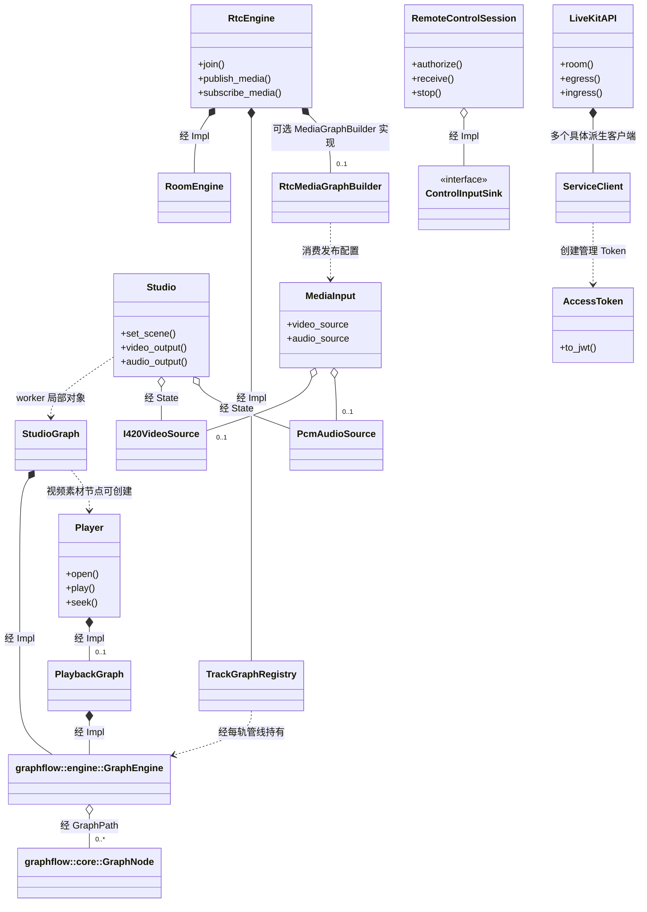

GraphEngine 管理通用生命周期，媒体节点承载 WebRTC / FFmpeg / 平台能力。RemoteControlSession 的输入授权不依赖 GraphEngine；其屏幕传输由应用另行组合 RTC。LiveKitAPI 是管理 API 客户端，不是 RtcEngine 的基类或所有者。

源码：[RTC 门面](../../../livekit-sdk-cpp/include/livekit/rtc/engine.hpp)、[Player](../../../livekit-sdk-cpp/include/livekit/player.hpp)、[Studio](../../../livekit-sdk-cpp/include/livekit/studio.hpp)、[ServerSDK](../../../livekit-sdk-cpp/include/livekit/api.hpp)。

## 01 · RTC 总体类图

一个 Session worker 创建一个 RtcEngine。RtcEngine 统一编排房间端点、媒体构图、图注册与回滚。TrackGraphRegistry 不依赖 RoomEngine；RtcMediaGraphBuilder 不依赖注册表，只接收每轨 RTC 节点并返回 PreparedMediaGraph。

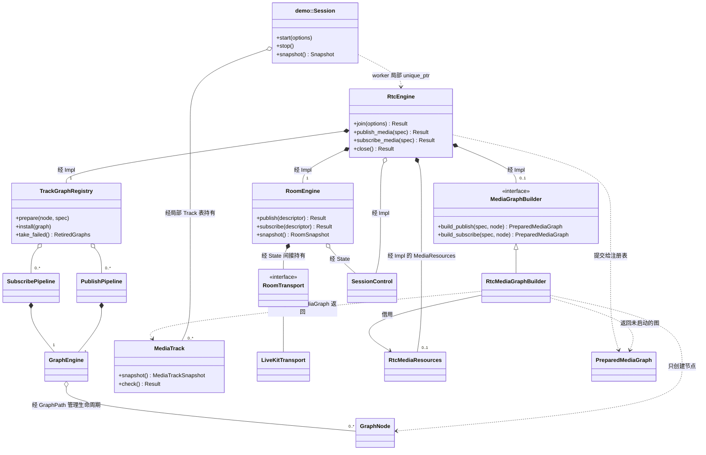

`MediaTrack` 不是 GraphEngine 的所有者；它共享节点/端点状态用于观测。撤掉一条轨道不会让其他轨道退会。SDK 总体还包含 Player、Studio、RemoteControl、ServerSDK，见图 11–14；它们不是会议示例的必经层。

源码：[示例运行时](../../../livekit-sdk-cpp/examples/conference_viewer/session_runtime.cpp)、[门面 Impl](../../../livekit-sdk-cpp/src/engines/rtc/rtc_engine_impl.hpp)、[媒体模块](../../../livekit-sdk-cpp/src/engines/rtc/media_graph_builder.hpp)。

## 02 · 示例应用与 SDK 入口

View 和 Session 在 main 中并列创建，由主循环把 Action 转成 Session 操作；View 不拥有 Session。Session 的 SDK 控制调用在 worker 上执行。视频回调只替换共享帧，UI 再上传 SDL 纹理。

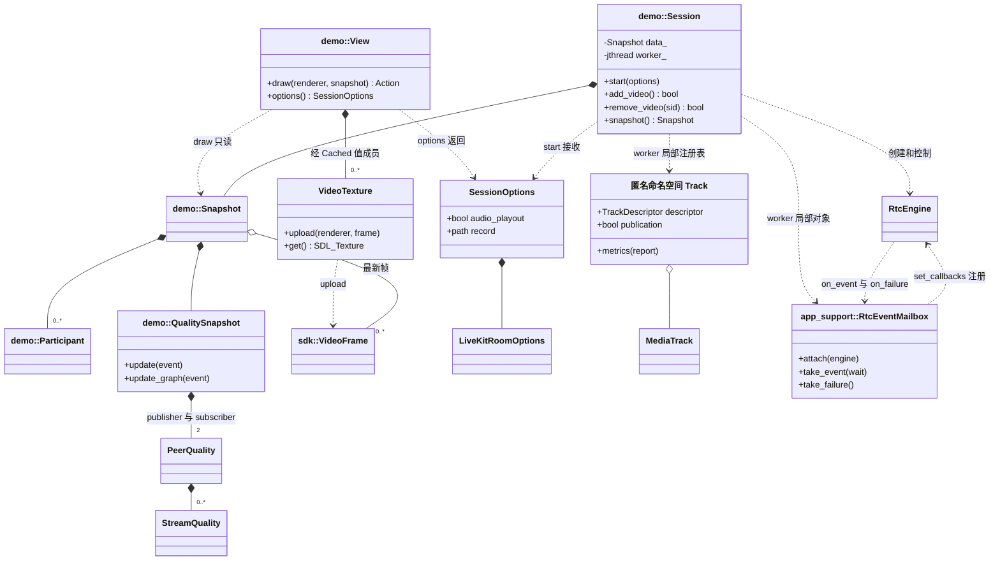

QualitySnapshot 另外有独立的 graph_sample；图中“两条 PeerQuality”特指原生 publisher/subscriber 连接统计。示例循环每 5 ms 消费应用 mailbox，不是旧版 SDK `poll()` 执行模型。

源码：[Session](../../../livekit-sdk-cpp/examples/conference_viewer/session.hpp)、[View](../../../livekit-sdk-cpp/examples/conference_viewer/ui.hpp)、[质量模型](../../../livekit-sdk-cpp/examples/conference_viewer/quality.hpp)、[Mailbox](../../../livekit-sdk-cpp/support/rtc_event_mailbox.hpp)。

## 03 · 公共门面、媒体配置与句柄

普通调用方只提交配置；RtcMediaGraphBuilder 负责据此创建节点。`create_livekit_engine(AudioOutputOptions)` 会安装媒体模块，无参版本只创建编码传输门面。

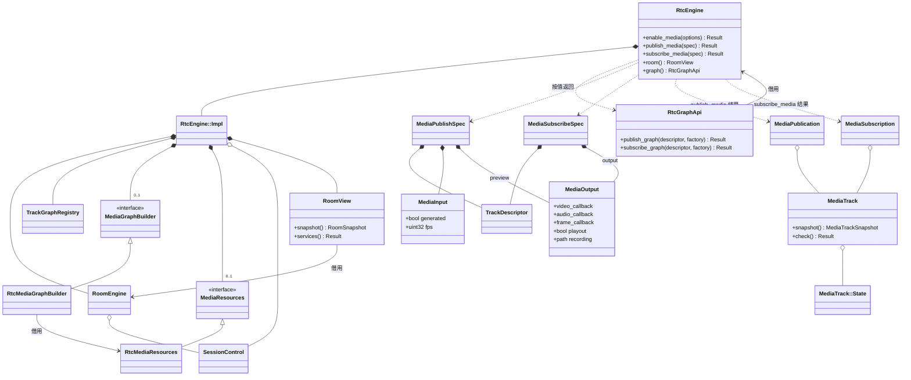

`RtcGraphApi` 是显式引入 `graph_api.hpp` 后才使用的高级扩展，示例未调用。返回值中的 MediaTrack 可保留用于最终状态查询，图的关闭仍由引擎控制。

源码：[engine.hpp](../../../livekit-sdk-cpp/include/livekit/rtc/engine.hpp)、[media_config.hpp](../../../livekit-sdk-cpp/include/livekit/rtc/media_config.hpp)、[graph_api.hpp](../../../livekit-sdk-cpp/include/livekit/rtc/graph_api.hpp)。

## 04 · 每轨管线与 GraphFlow 生命周期

发布与订阅分别构图。注册表停止图后返回 RetiredGraphs 保留资源；RtcEngine 等待端点解绑完成后释放它们。TrackGraphSpec 的 quiesce 回调先静止媒体 worker。独立使用的 PublishPipeline / SubscribePipeline 仍自行关闭端点。

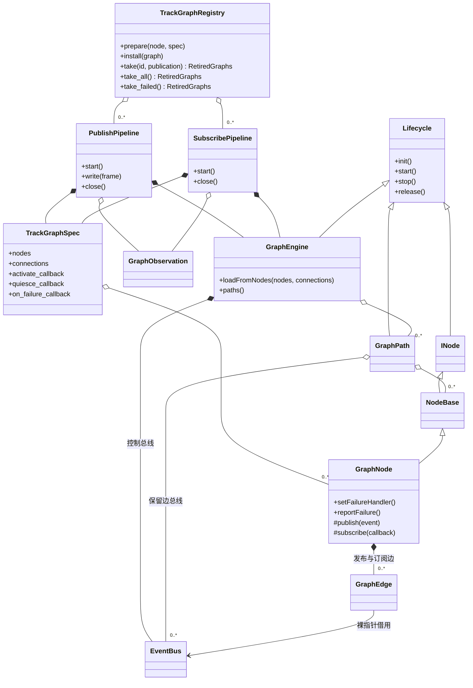

图省略了 GraphEngine 的 JSON builder、工厂及 Blackboard 等成员。示例的每轨图使用已有节点实例构图，节点会被 GraphPath、TrackGraphSpec、媒体状态等多个 shared_ptr 同时持有。

源码：[图注册表](../../../livekit-sdk-cpp/src/engines/rtc/track_graph_registry.hpp)、[轨道管线](../../../livekit-sdk-cpp/include/livekit/rtc/stream_pipeline.hpp)、[GraphEngine](../../../graphflow-cpp/engine/graph_engine.h)、[GraphNode](../../../graphflow-cpp/core/graph_node.h)。

## 05 · 发布模块：输入、编码与反馈

示例每路测试视频使用 VP8，测试音调使用 Opus。VideoCodecNode 与 AudioCodecNode 是两种分支，不会在一条轨道中串接。虚线事件箭头表示经图连接传递，不是节点互相持有指针。

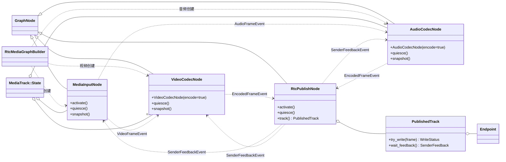

编码输入扩展可由 MediaInputNode 直接输出 EncodedFrameEvent，跳过实际编码。`follow_subscriber_demand` 的反馈会作用于输入和编码节点。RtcPublishNode 不拥有采集器、编码器或房间。

源码：[build_publish 构图](../../../livekit-sdk-cpp/src/engines/rtc/media_graph_builder.cpp)、[输入节点](../../../livekit-sdk-cpp/include/livekit/rtc/input_node.hpp)、[视频节点](../../../livekit-sdk-cpp/include/livekit/rtc/video_nodes.hpp)、[音频节点](../../../livekit-sdk-cpp/include/livekit/rtc/audio_nodes.hpp)。

## 06 · 订阅模块：解码、同步、显示与播放

视频经 ApplicationOutput 回调送到示例 Snapshot；音频经 AudioOutputNode 进入共享输出设备。录制由 RecordingNode 承担。

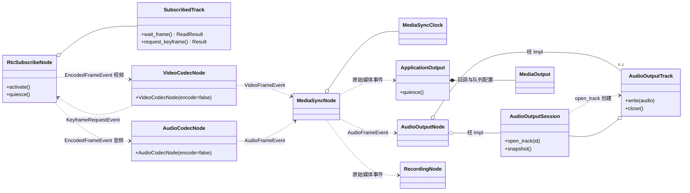

这些媒体节点均继承 GraphNode（本图省略继承扇出）。MediaSyncNode 仅在 `synchronize && !source_id.empty()` 时创建，否则解码节点直连输出；音视频按 `(source_id, stream_group)` 共享时钟。AudioCodecNode 普通订阅默认启用 NetEq。AudioOutputNode 仅在 playout 开启时创建；RecordingNode 仅在 recording 路径非空时创建。

源码：[订阅构图](../../../livekit-sdk-cpp/src/engines/rtc/media_graph_builder.cpp)、[同步节点](../../../livekit-sdk-cpp/src/engines/rtc/sync_node.hpp)、[应用回调输出](../../../livekit-sdk-cpp/src/engines/rtc/application_output.hpp)、[音频输出](../../../livekit-sdk-cpp/include/livekit/rtc/audio_output.hpp)。

## 07 · 房间、轨道端点与控制模块

RoomEngineState 管理协议状态、命令、截止时间、epoch 和轨道注册表。PublishedTrack / SubscribedTrack 共享 Endpoint，但仅弱引用房间状态。

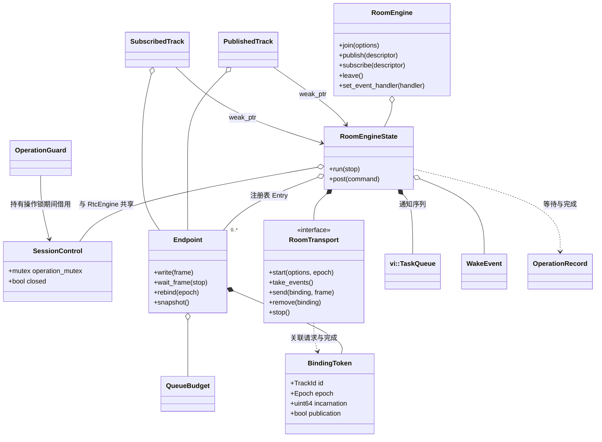

同步控制在应用线程取得 operation mutex 并等待完成；协议推进在 room worker，通知在 TaskQueue。控制锁、状态锁和通知队列不是同一机制。BindingToken 防止旧 epoch 或同 ID 的旧实例完成错误作用于新轨道。

源码：[Room API](../../../livekit-sdk-cpp/include/livekit/rtc/room_engine.hpp)、[RoomEngineState](../../../livekit-sdk-cpp/src/backends/rtc/room_engine.cpp)、[Endpoint](../../../livekit-sdk-cpp/src/backends/rtc/endpoint.hpp)、[控制锁](../../../livekit-sdk-cpp/src/backends/rtc/control_context.hpp)。

## 08 · LiveKit 信令与 WebRTC 后端

LiveKitTransport 是 RoomTransport 的具体实现。SignalSession、publisher/subscriber NativePeer 是会话执行过程中的局部对象，不是 LiveKitTransport 的直接成员。

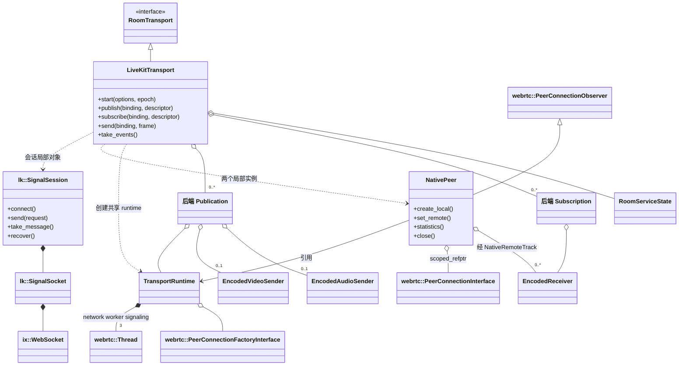

scoped_refptr 在本图按共享引用绘制。这里的编码 sender/receiver 承担编码媒体与传输交接；实际编解码位于图 05/06 的媒体节点。当前 SDK 适配器仍拒绝 single-PC 配置，不能把 C++ SFU 已有的单 PC 支持画成 SDK 已实现能力。

源码：[LiveKitTransport](../../../livekit-sdk-cpp/src/backends/rtc/livekit/livekit_transport.cpp)、[SignalSession](../../../livekit-sdk-cpp/src/backends/rtc/livekit/signal_session.hpp)、[NativePeer](../../../livekit-sdk-cpp/src/backends/webrtc/native_peer.hpp)、[TransportRuntime](../../../livekit-sdk-cpp/src/backends/webrtc/transport_runtime.hpp)。

## 09 · 帧、时间、队列和错误契约

原始视频与音频事件继承共同的 FrameTiming；编码帧单独携带时间信息，不继承 FrameTiming。FrameView 的 owner 保证 planes 指向的数据存活。

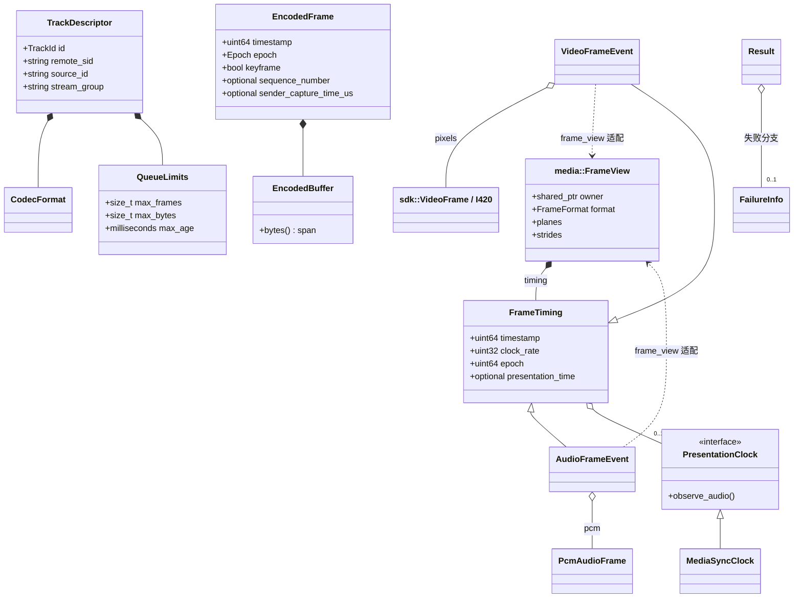

FrameView 只表达 CPU 内存视图。EncodedBuffer 的副本共享只读负载和预算租约。不同层的 TrackSnapshot、RoomEvent、GraphFailure 可保留同一 FailureInfo，用 failure id 关联错误。

源码：[RTC 类型](../../../livekit-sdk-cpp/include/livekit/rtc/types.hpp)、[FrameView](../../../livekit-sdk-cpp/include/livekit/media_core/frame_view.hpp)、[帧适配](../../../livekit-sdk-cpp/include/livekit/rtc/frame_view.hpp)、[Result](../../../livekit-sdk-cpp/include/livekit/result.hpp)。

## 10 · 可选共享输入与音频处理

本示例为每条测试流创建独立输入；没有调用 create_shared_input。下面是 SDK 已实现的可选能力，不是示例默认运行对象。

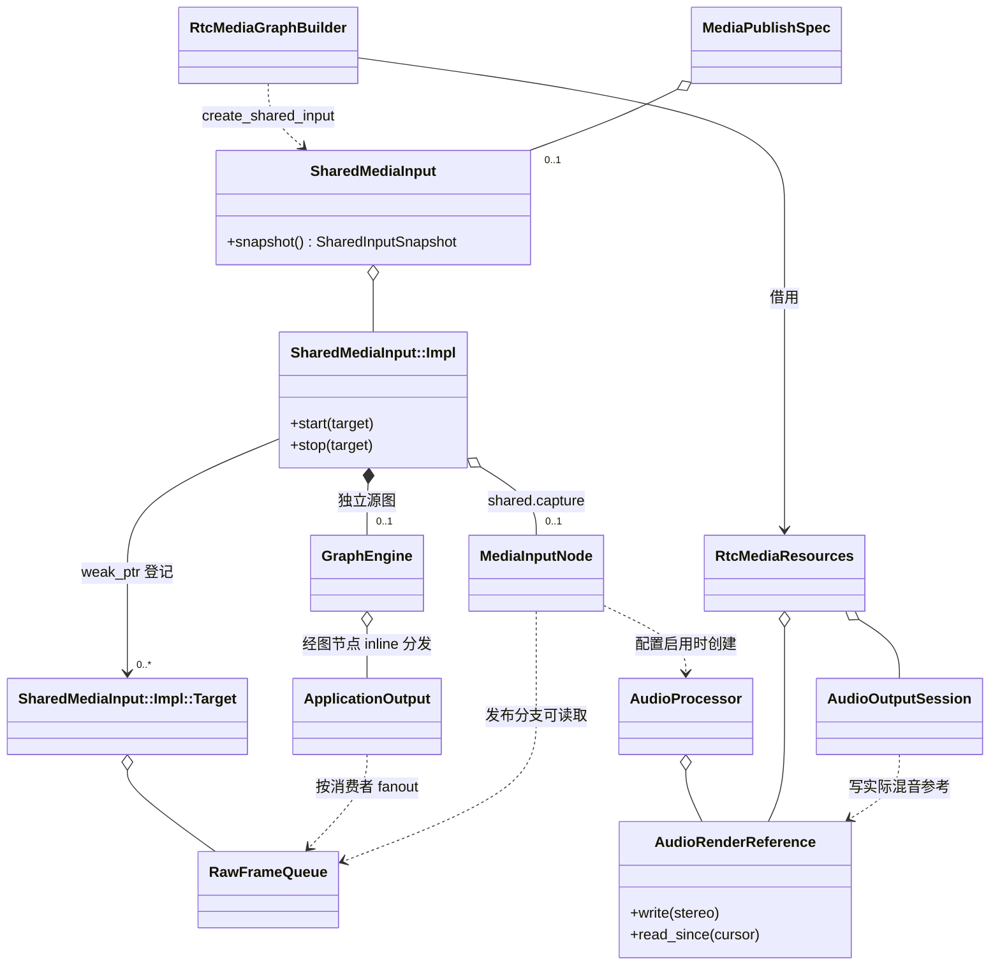

MediaInputNode 在此同时表示源图的采集实例和每条发布图的读取实例，二者是不同对象。首个消费者启动采集，最后一个退出停止；各分支队列独立，原始负载共享。APM 可在共享采集处分发前执行一次。

源码：[共享输入实现](../../../livekit-sdk-cpp/src/engines/rtc/media_graph_builder.cpp)、[RawFrameQueue](../../../livekit-sdk-cpp/src/media_graph/raw_frame_queue.hpp)、[AudioProcessor](../../../livekit-sdk-cpp/src/media_nodes/capture/audio_processor.hpp)。

## 11 · 房间数据服务与 ServerSDK

这两组是不同模块：RoomServices 属于已入房会话；LiveKitAPI / AccessToken 属于可信服务端管理能力。示例只直接使用 AccessToken 为本地测试签名，不调用 RoomServices 或 LiveKitAPI。

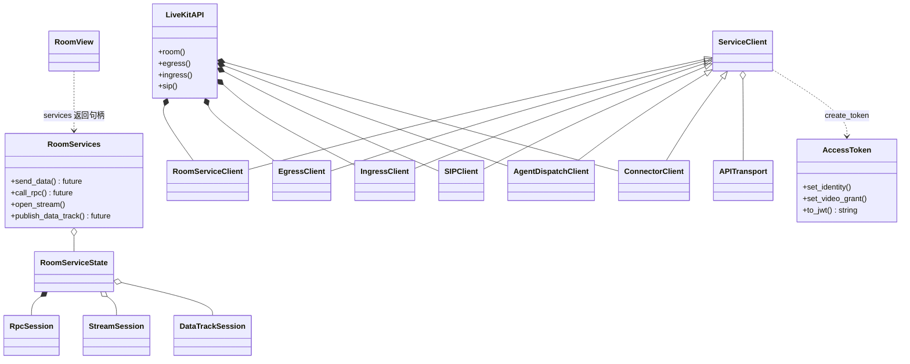

`demo::username_options()` 使用 AccessToken 生成 token 后写入 LiveKitRoomOptions；正式客户端的 token 通常来自业务服务。图中的服务端客户端 API 存在，不代表对端 C++ 媒体服务已实现所有管理能力。

源码：[RoomServices](../../../livekit-sdk-cpp/include/livekit/rtc/room_services.hpp)、[RoomServiceState](../../../livekit-sdk-cpp/src/backends/rtc/livekit/room_service_state.hpp)、[Server API](../../../livekit-sdk-cpp/include/livekit/api.hpp)、[签名示例](../../../livekit-sdk-cpp/examples/conference_viewer/connection.cpp)。

## 12 · Player 模块（示例未使用）

播放器独立构建，不需要会议 RTC 链路。其 MediaNode 是 SDK 内部的播放媒体节点基类，不等同于所有 RTC 节点的共同基类；后者直接继承 GraphNode。

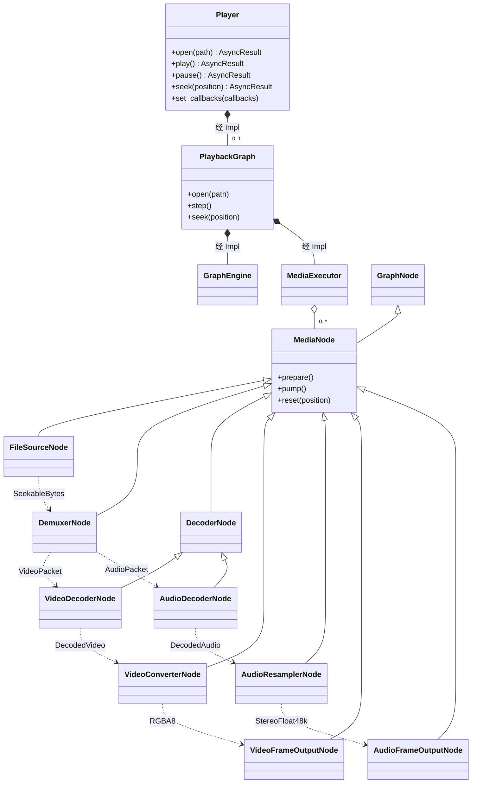

FileSourceNode 与 DemuxerNode 之间还存在经控制总线传递的 FileIORequest 请求；图强调前向媒体数据依赖，未列出所有边。VideoFrameOutputNode / AudioFrameOutputNode 是 PlaybackOutputNode 模板的类型别名。输出通过 PlayerCallbacks 交给应用渲染与播放。

源码：[Player](../../../livekit-sdk-cpp/include/livekit/player.hpp)、[PlaybackGraph](../../../livekit-sdk-cpp/src/engines/player/playback_graph.cpp)、[MediaExecutor](../../../livekit-sdk-cpp/src/media_graph/media_flow.hpp)、[FFmpeg 节点](../../../livekit-sdk-cpp/src/backends/ffmpeg/ffmpeg_playback.hpp)。

## 13 · Studio 模块（示例未使用）

Studio 通过自己的 GraphEngine 组织素材、混音和合成；输出 I420VideoSource / PcmAudioSource 可供 RTC 发布。Studio 不拥有 RtcEngine。

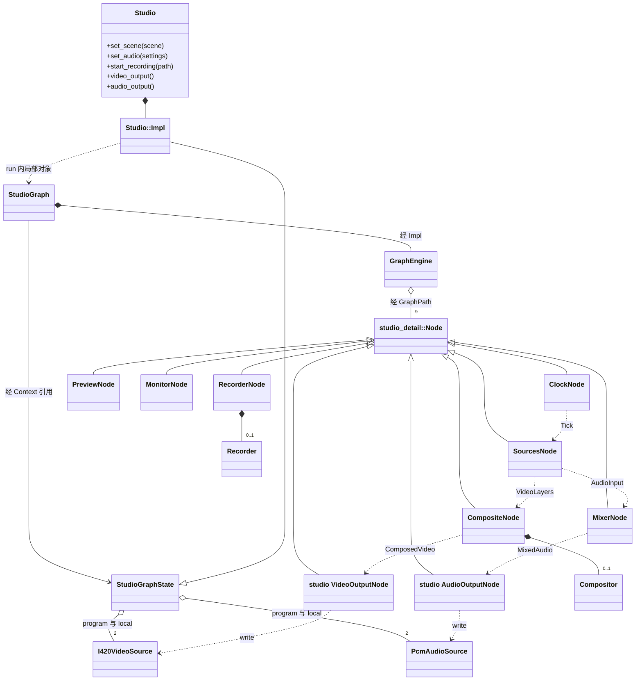

Node 继承 GraphNode，本图省略其公共父类。PreviewNode、MonitorNode、RecorderNode 还消费合成/混音事件；SourcesNode 按素材创建 Capture、AudioCapture 或 Player。这里的 studio AudioOutputNode 与图 06 的 rtc::nodes::AudioOutputNode 是不同类。

源码：[Studio](../../../livekit-sdk-cpp/include/livekit/studio.hpp)、[StudioGraphState](../../../livekit-sdk-cpp/src/engines/studio/studio_graph.hpp)、[Studio 构图](../../../livekit-sdk-cpp/src/engines/studio/studio_graph.cpp)。

## 14 · RemoteControl 模块（示例未使用）

RemoteControlSession 是权限与输入协议会话，不拥有 RTC 房间或屏幕传输图。应用把收到的数据和授权状态交给它。

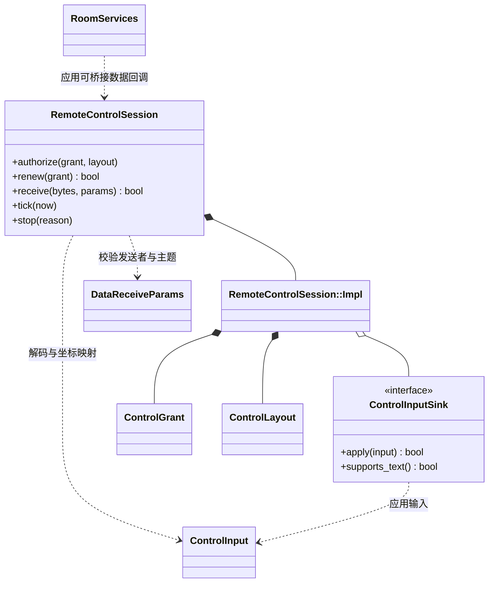

最后一条虚线表示应用组合方式，SDK 内不存在 RoomServices 直接调用 RemoteControlSession 的成员关系。平台输入适配由 make_platform_control_input 工厂提供，控制权限不由 UI 单独决定。

源码：[远控 API](../../../livekit-sdk-cpp/include/livekit/remote_control.hpp)、[远控状态与协议](../../../livekit-sdk-cpp/src/scenarios/remote_control/remote_control.cpp)。

## 示例主链路速查

1. main 调用 View::options，经 username_options / AccessToken 生成 SessionOptions。
2. Session::start 启动 worker，创建带媒体模块的 RtcEngine，注册 RtcEventMailbox，调用 join。
3. 每个本地 MediaSpec 转成 MediaPublishSpec；RtcEngine 创建发布端点，RtcMediaGraphBuilder 创建输入/编码节点，TrackGraphRegistry 初始化并启动每轨 GraphEngine。
4. 收到 remote_track_added 后创建 MediaSubscribeSpec；订阅图将编码帧解码为视频或 PCM。
5. 视频回调保留共享 VideoFrame 到 Snapshot，UI 使用 VideoTexture 上传；音频由共享 AudioOutputSession 播放。
6. 移除单轨仅关闭对应管线；退出时 engine.close 先停止媒体工作，再清理传输。应用 worker 结束后 Session 才完成回收。

## 验证范围

本图册以源码静态关系为依据，渲染验证仅检查类图语法与可显示性；没有运行会议、连接服务器或操作用户桌面。图中未画出的类不表示不存在；公共方法为阅读目的做了签名简化。

已通过 15 张 Mermaid 类图的解析和 SVG 渲染，检查图册缩放、页面溢出及 54 个源码链接。详见 [validation.json](validation.json)。

## 重新生成图册

Mermaid 源码以本文件为准。渲染脚本使用现有 `livekit-cpp/tests/node_modules/playwright`，以无窗口 Chromium 生成 SVG、总览 PNG 和内嵌 SVG 的 HTML，不操作桌面。当前使用 Mermaid 10.9.3；从聚合仓库根目录运行：

```powershell
# mermaid.min.js 放在生成目录，不需要随图册提交。
New-Item -ItemType Directory -Force out/sdk-class-diagrams | Out-Null
Invoke-WebRequest 'https://cdn.jsdelivr.net/npm/mermaid@10.9.3/dist/mermaid.min.js' -OutFile out/sdk-class-diagrams/mermaid.min.js
node docs/architecture/sdk-class-diagrams/render.cjs out/sdk-class-diagrams/mermaid.min.js
```

可用第二个参数指定 Chrome/Chromium 可执行文件；默认使用 `C:/Program Files/Google/Chrome/Application/chrome.exe`。图册本身不需要 Node、Mermaid 或外网。
