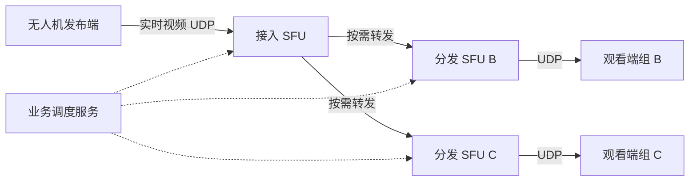

# 无人机音视频 SFU 开源方案对比：LiveKit、Janus、mediasoup 与 Jitsi

评估日期：2026-10-27（北京时间）。

- 需求基线：[无人机音视频 SFU 需求说明 V1.11](../../../sdk/无人机音视频%20SFU%20需求说明.md)，共 34 项需求。
- 对比对象：本地 Go LiveKit Server、Janus VideoRoom、mediasoup v3、Jitsi Videobridge（JVB）配合 Jicofo。
- 关联报告：[Go LiveKit 需求评估](uav-sfu-go-requirements-assessment.md)、[当前 C++ 版本需求评估](uav-sfu-requirements-assessment.md)。
- 本文新增选型比较，不修改需求或既有评估；不把开源项目的接口、文档描述视为本项目实机验收结果。

## 1. 选型结论

**不存在已被本次评估证明可以原样满足全部需求的方案。是否必须拆分单个热门房间，是选择方向的重要分界。**

| 项目条件 | 建议方向 | 原因与边界 |
| --- | --- | --- |
| 多架无人机、多房间，总体负载增长；单房间仍在单节点容量内 | 继续以 Go LiveKit 为主要候选 | 已有房间调度、SDK、鉴权和媒体能力；新增节点可以分担不同房间，但不能自动拆分已有热门房间 |
| 同一路无人机视频需要跨服务器分发给大量观看者 | 优先验证 Janus，同时对照 mediasoup | Janus 有明确的远端发布者及房间级联 API；mediasoup 有灵活的媒体管道。两者均需要应用层调度和状态管理 |
| 希望长期掌控媒体拓扑、订阅和传输策略，能承担较多平台开发 | 优先考虑 mediasoup | 提供底层媒体能力，业务信令和编排自由度高；现成业务体系少，跨主机级联不是一个开关 |
| 以多人会议、多人互动为主，希望复用跨桥会议编排 | 优先考虑 Jitsi JVB + Jicofo | 配套支持同一会议使用多个媒体桥；无人机接入、自定义回放和业务界面需要适配会议体系 |
| 必须保留现有 LiveKit 客户端协议和 SDK | 继续 LiveKit，另评估级联开发或媒体桥接 | 其他三个方案不能直接替换 LiveKit 服务端并保持原协议不变 |

此前 Go 报告“优先作为实现基础”的结论来自 Go LiveKit 与当前 C++ 项目的对比；本文增加了开源级联候选，因此对**单房间跨节点分发**给出不同的条件化建议，不代表已决定迁移。

推荐先完成两项技术验证：**Janus 双节点实时视频级联**，以及**候选方案在目标机载和三端上的 TCP 回放**。后者可能直接影响总体架构，不能等大规模级联完成后才验证。

## 2. 需求边界和证据口径

### 2.1 必须保持的业务约束

1. 多摄像头独立发布、独立订阅，同源多人观看不让设备按观看者重复上传。
2. 多人全双工共享语音，至少无人机与两名用户同时互听；不需要私有音频或独占对讲锁，仍需授权。
3. 无 TURN，设备和观看端直连 SFU；不可达时明确失败，不使用不符合要求的协议兜底。
4. 实时视频：设备 → SFU、SFU → 观看端两段均为 UDP。
5. 回放视频：上述两段均为 TCP；回放源由设备发布，录像检索、文件读取、seek 和倍速由外部模块负责。
6. 实时视频需要 H.265 → H.264 全体回退：出现不兼容观看者后，源端和原有观看者均切到 H.264；不能只给新观看者补发另一编码。回放不套用这一自动回退规则。
7. 维持 QoS、独立背压、默认 1 s 质量采样、权限、代次隔离、时延和长稳要求。

**SFU 间新增链路的协议需要在级联设计中明确。** V1.11 已明确的是设备和观看端两侧；原文未单列跨 SFU 链路。建议实时级联使用 UDP；如果回放也要求跨 SFU 全程 TCP，应将这一点纳入设计及后续需求修订。本文不擅自把建议写成既有验收要求，但同时给出这一更严格口径下的限制。

语音没有新增“必须 UDP”的独立要求。若与实时媒体共用 UDP 连接，会随该连接使用 UDP；不要把这一架构选择表述为用户已规定的音频协议。

### 2.2 证据基线

| 方案 | 本次基线 | 核查深度 |
| --- | --- | --- |
| Go LiveKit | 本地提交 `a390d03d28c895742d9b13c0894880ee67733801`，源码版本字段为 `1.13.10` | 已有专项报告；检查房间分配、媒体解析、信令转发及依赖中的传输实现 |
| Janus | 官方 VideoRoom 文档；查询到 master 提交 `b10d8d353b09ecb3a8cccf171ba0ac18284c1451` | 核查远端发布者 API 和源码许可；未完成全量源码审计、部署和设备适配 |
| mediasoup | 官方 v3 文档；v3 分支提交 `bd8bb8e5fcb01ddf909373036f807ab24114ea62` | 核查跨主机扩展说明、WebRTC 传输 API、PipeTransport 的 UDP 限制和许可 |
| Jitsi | JVB 提交 `23dd9f5bc54025bf6b4aaa0b6349e3ab6fa2082b`；Jicofo 提交 `0f63945e629765e85046704b4d8ddac79b54f0b4` | 核查 Relay 部署文档、区域选桥策略和 JVB 许可 |

在线文档可能随主分支更新；表中的提交用于记录查询时的源码快照，不表示这些提交已组成可交付的兼容发行组合。正式 PoC 必须锁定服务端、客户端、依赖和部署配置。LiveKit Cloud 或未公开商业实现不在对比范围。

本文“已有”表示发现对应机制；“待验证”表示缺少本需求所需证据，不等于认定该项目不支持。对其他三个方案的核查深度低于本地 LiveKit，不用未核查项给它们打虚假的高分。

## 3. 总体能力比较

| 维度 | Go LiveKit | Janus VideoRoom | mediasoup | Jitsi JVB + Jicofo |
| --- | --- | --- | --- | --- |
| 产品形态 | 带房间、SDK 和服务 API 的媒体平台 | 媒体网关及插件，VideoRoom 提供 SFU | 媒体开发库，应用自行定义信令和业务 | 会议媒体桥及会议控制组件，可配合 Jitsi Meet |
| 主要实现语言 | Go | C | C++ 媒体 worker，Node.js/TypeScript 控制 API | Java/Kotlin；完整前端另有技术栈 |
| 多房间横向扩容 | Redis 路由、节点选择已有 | 业务层分配房间和节点 | 应用分配 worker、Router 和节点 | Jicofo 选择会议媒体桥 |
| 同一逻辑房间跨节点媒体分发 | 本地开源路径未发现完整可用实现 | 有远端发布者、跨 VideoRoom 转发 | 有 PipeTransport，可跨主机连接 | 有 Relay / secure Octo，配合多桥会议编排 |
| 跨节点调度完成度 | 已有房间级调度，缺单房间媒体级联闭环 | 级联 API 已有，调度和同步自行开发 | 管道已有，跨机信令及调度自行开发 | 配套较完整，仍需选择策略与业务接入 |
| 多人音频 | 多成员多轨 SFU 基础已有 | VideoRoom 可转发多名发布者音频 | 多 Producer/Consumer 可承载多人音频 | 多人会议为主要用例 |
| 机载 Linux ARM64 | 要单独交付采集、硬编、音频和客户端 | 同左，需适配 Janus 信令及媒体会话 | 同左，需实现业务信令和端侧适配 | 同左，需适配会议接入及信令体系 |
| 客户端业务接入 | 可复用 LiveKit SDK 和身份体系 | 按 Janus 插件协议改造 | 自建业务信令，使用对应端侧库或 WebRTC 实现 | 接入 Jitsi 会议体系，定制无人机交互 |
| 相对迁移范围 | 保留 LiveKit 时较小，开发级联时增加 | 客户端会话、后台调度、事件模型需改造 | 客户端与后台媒体控制需较大改造 | 需适配会议模型、客户端及部署体系 |
| 核心许可 | Apache-2.0 | GPL-3.0 | ISC | JVB 为 Apache-2.0 |

许可按本次查看的核心仓库文件记录，完整交付还需按实际使用的组件及依赖确认。多人语音中的多路解码、播放混音和 AEC 仍需端侧实现及验收；Janus AudioBridge 的混音模式不作为本文 SFU 语音方案。

## 4. 级联实现与满载扩容

### 4.1 Go LiveKit：分配房间已有，拆分房间需要开发

本地 `StandardRoomAllocator.SelectRoomNode` 对已经分配且仍可用的节点保持原归属；达到配置限制时返回 `ErrNodeLimitReached`，不会把房间的一部分观看者自动放到另一台 SFU。[L1]

`RelaySignal` 是节点之间的信令转发。[L2] `IsRelayed`、下游节点质量反馈等接口说明代码保留了扩展点，但实际媒体创建设置 `IsRelayed: false`，订阅解析仍查询当前房间。[L3][L4] 这些接口不等于已经交付跨节点媒体服务。

适合的扩容方式是提前增加节点，让新房间落在有余量节点。不能指望加节点即时搬走满载房间，也不能把故障后重建等同于无缝迁移。

若保留 LiveKit，可选择：开发原生级联；或增加媒体桥接进程，在源房间订阅后向其他房间重新发布。桥接是新增组件，需处理权限、身份映射、回环、反馈、额外连接和 CPU/内存成本，不能当作当前服务端自带功能。

### 4.2 Janus：远端发布者构成明确的级联路径

官方文档直接命名为 “Remote publishers (room cascading)”。[J1]

典型流程：

1. 在目标 Janus 调用 `add_remote_publisher`，注册远端发布者并取得接收地址和端口。
2. 在源 Janus 调用 `publish_remotely`，把该发布者的媒体转发到目标节点。
3. 目标节点观看者按普通 VideoRoom 订阅接口订阅远端发布者。
4. 发布者重新协商、增减轨道时，控制服务调用 `update_remote_publisher` 同步变化。
5. 发布结束时执行 `unpublish_remotely` 和 `remove_remote_publisher`，清理两端资源。

同一源可以建立到多个目标节点的转发关系，适合无人机一次上传、多节点分发。它不是自动复制全房间：应用需要维护哪些源在哪些节点被订阅、什么时候建立或撤销转发。

多人语音若分散在多个节点，需要把各发言者的音频送达有订阅需求的节点，避免自回送和重复转发。权限撤销、节点故障、重复调用及发布代次隔离均需纳入控制服务。

### 4.3 mediasoup：媒体管道灵活，跨主机控制由应用负责

`router.pipeToRouter()` 用于同一主机内的 Router 互联；官方扩容文档明确说明跨主机可采用相同思路，但要自行处理网络信令。[M1][M2]

跨主机实现需要分别建立 PipeTransport，交换连接及媒体参数，在目标节点创建对应 Producer，再向观看者创建 Consumer。生命周期、订阅需求、断线重试和身份映射由应用管理。

一个 worker 使用一个 CPU 核进行媒体处理，多 worker 分担负载；单个 Router 的负载和跨 worker 管道成本都要单独测量，不能用整机平均 CPU 掩盖单 worker 饱和。[M1]

**当前 PipeTransport 只接受 UDP。** 源码对非 UDP 的监听协议直接报错。[M3] WebRtcTransport 支持 TCP 候选不能推出 PipeTransport 支持 TCP；因此若要求回放跨 SFU 链路也为 TCP，不能直接复用该管道完成。

### 4.4 Jitsi：Relay 与会议调度配套

JVB 的 Relay（secure Octo）在媒体桥之间使用 ICE、DTLS/SRTP，并配有跨桥消息通道；文档说明了 Relay 开关、region、relay-id 和 Jicofo 多桥配置。[T1]

Jicofo 的 `RegionBasedBridgeSelectionStrategy` 会结合区域及负载选择媒体桥；代码包含在已有桥过载时选择其他桥的逻辑。[T2] 这为新加入成员使用其他桥提供基础，不代表将已有连接无缝迁移，也不代表能够保证任意规模会议。

`SplitBridgeSelectionStrategy` 可用于验证跨桥工作，但不应直接当作生产负载策略。部署文档还提示，同一会议中的媒体桥版本兼容需要关注。[T1]

Relay 文档中的 WebSocket/SCTP 是跨桥消息通道信息，不能据此声称视频通过 TCP。回放 TCP 要独立证明媒体路径。

### 4.5 级联能解决的瓶颈

图中只展示实时视频单向分发；语音需要按发布者和订阅关系补充双向媒体路径，TCP 回放单独设计。

假设一路 2 Mbps 视频、1,000 名观看者，不计协议头和重传，单 SFU 的观看出口负载约为 2 Gbps。若均分到 4 个分发节点，每个分发节点约承担 500 Mbps；接入节点只向这 4 个节点各送一份该编码流时，对应源的级联出口约为 8 Mbps。这只是负载计算示例，不是容量承诺；音频、重传、多编码层和本地观看者需另计。

级联主要分担观看扇出。无人机自身上行不足、接入节点收到过多独立源、发布端编码器过载，不能靠增加观看侧节点直接解决。接入节点故障仍会影响其下游，需另行重建源连接及转发关系。

## 5. 实时 UDP、回放 TCP 与无 TURN

| 方案 | 实时视频两侧 UDP | 回放视频两侧直连 TCP | 跨 SFU 回放若也要求 TCP |
| --- | --- | --- | --- |
| Go LiveKit | 已有 UDP 基础；需关闭 TCP 回退并验证两侧实际路径 | 已发现被动 ICE-TCP、TCP mux、ForceTCP 基础；要验证目标客户端主动 TCP 能力 | 当前无完整级联实现，须随新增级联一并设计 |
| Janus | WebRTC UDP 可作为实时路径；需配置及抓包验证 | 本次未证明目标版本、ICE 库和三端具备完整 TCP-only 回放闭环 | 本次远端发布者证据不足以证明 TCP 级联可用，不列为现成能力 |
| mediasoup | WebRtcTransport 可提供 UDP 候选，需按连接落实策略 | WebRtcTransport 提供 TCP 监听/候选能力，目标端兼容和两侧 TCP-only 仍需验证 | PipeTransport 明确仅支持 UDP，需要其他桥接或独立 TCP 回放通路 |
| Jitsi | 常规 WebRTC 路径可作为候选，需限制和验证选路 | 本次未证实当前部署组合在无 TURN 下的两侧 TCP-only 回放能力 | Relay 的消息通道使用 WebSocket 不构成 TCP 视频证据，需专项验证 |

LiveKit 目前对 Go 客户端的主动 ICE-TCP 能力有明确限制，详见 Go 专项报告；服务端使用 Go 不代表任意 Go 发布客户端都能走 TCP。

四种方案都必须遵守以下实现原则：

- 实时与回放建立独立媒体连接或独立传输实例；同一共享传输不能同时按轨道承诺 UDP-only 和 TCP-only。
- 验证服务端 ICE 候选、客户端能力及实际选中路径；`preferTcp`、WSS 信令或读取本地录像使用 TCP 均不是充分证据。
- 不配置或使用 TURN；部署负责公开可达地址、端口及网络映射，协议不可达时明确报错。
- 每个 TCP 订阅独立设置应用队列上限、写入超时和恢复边界，避免慢观看者影响其他订阅、实时视频及语音。

需求允许回放使用非 WebRTC 媒体协议。因此可单独实现带 TLS 的 TCP 回放接入和分发服务，但需同时满足两侧 TCP、鉴权、同源多人转发、端侧播放、背压和时延目标。采用这一方案应计入新增开发成本，不能记为上述 SFU 原生完成，也不应扩大成云端录像或检索系统。

## 6. 与现有需求的匹配和缺口

本表按相关需求分组，用于确定选型验证范围；不替代 34 项逐条验收。

| 需求组 | Go LiveKit | Janus | mediasoup | Jitsi |
| --- | --- | --- | --- | --- |
| 多摄像头、多观看者、按需发布（V-01/02/08/11） | 多轨、订阅和 dynacast 基础较完整 | VideoRoom 多发布者/订阅基础；跨节点需求聚合要补 | Producer/Consumer 基础；聚合和机载控制由应用实现 | 会议多源基础；无人机/摄像头身份及按需硬编需适配 |
| 实时编码全体回退（V-12） | H.265/H.264 和 REGRESSION 已有；机载及全体端闭环待验 | 本次未证明同等全体回退机制；编码协商、级联更新和机载切换专项验证 | 本次未证明同等机制；需协调源端、目标 Router 和各 Consumer | 本次未证明同等机制；需验证会议栈及端侧编码能力 |
| 实时 UDP、回放 TCP（V-13/B-07） | 有直接传输基础，需实例/连接分流和端侧验证 | UDP 候选可行，TCP 专项未完成 | WebRTC UDP/TCP 能力有文档，PipeTransport 为 UDP | UDP 候选可行，TCP 专项未完成 |
| 多人语音及成员生命周期（A-01/02/05/06） | 房间/权限/事件基础；业务代次与端侧混音待补 | 多音频发布及转发；跨实例成员和撤权由业务维护 | 多音频 Producer/Consumer；成员/授权体系自行开发 | 会议体系较完整；无人机授权及连接代次仍需适配 |
| 回放源、独立进度及结束（B-01/03/04/06） | 通用媒体转发可复用，回放业务语义需补 | 同左，另管级联资源生命周期 | 同左，由应用建立流和会话映射 | 需将回放源接入会议媒体模型或独立通路 |
| 拥塞、重传、关键帧、独立质量（N-02/Q-01/02/03/05） | 已有较多实现；按报告补齐可配置边界及端侧闭环 | 有 RTP/RTCP 基础，需逐项验证上下行及跨节点反馈 | 有媒体反馈与转发基础，需逐项验证预算及源端控制 | 有会议媒体质量机制，需按无人机单层源和桥间路径验证 |
| pacing、有界队列、音视频 FEC（Q-06/07） | 专项报告确认 pacing 接线/队列和视频 FEC 缺口 | 未完成源码级核查，不判通过 | 未完成完整核查，不以 RTP 能力推定 FEC 或 TCP 背压满足 | 未完成完整核查，不以会议可用推定满足 |
| 1 s 指标及业务追踪（Q-08/N-09） | 有统计和监控，需补 1 s 全链路及业务关联 | 需整合服务端、终端和级联指标 | 需整合各 transport、终端及业务指标 | 需整合桥、会议、终端及业务指标 |
| 故障隔离和重建（V-04/N-04/05） | 有重连和调度基础，不承诺无缝迁移 | 需重建远端发布者、源及订阅关系 | 需重建管道、Producer/Consumer 及业务状态 | 有会议多桥基础，实际断桥恢复和端侧行为待验 |
| 时延、容量、长稳与配额（N-01/06/08、P-02/03/10/11） | 目标设备未测，已有部分限额 | 目标设备未测，需实现/验证准入 | 目标设备未测，需实现/验证准入 | 目标设备未测，选桥阈值不替代完整配额 |

H.265 支持应分为服务端 RTP 处理、客户端 SDP 协商、实际硬件解码三个层面。对 Janus、mediasoup 和 Jitsi，本次不据宣传或单一 codec 名称判为通过；更不能据 H.264 可播放推断 H.265 → H.264 的全体切换完成。

多人语音级联需要在所有候选方案中验证：不回送本端音频、不重复订阅同一远端源、退出只清理该成员、撤权立即停止相关媒体、源端断开后不保留幽灵成员。N 人每人发布一条音频并互听时，终端侧共有 N×(N−1) 份音频订阅；跨节点传输可按源共享，但末端转发和解码负载不会消失。

## 7. 开发与迁移工作量的组成

不根据语言或项目知名度给出工期。应先明确已有客户端资产和 PoC 结果，再拆分人力与里程碑。

| 工作包 | 保留 LiveKit | 迁移 Janus | 迁移 mediasoup | 迁移 Jitsi |
| --- | --- | --- | --- | --- |
| 客户端连接/信令 | 可复用现有 LiveKit 接入，补协议分流 | 改成 Janus 插件会话/发布订阅 | 定义业务信令，接入对应媒体库 | 接入会议信令及客户端体系 |
| 业务身份与权限 | 复用基础，补设备/会话/代次映射 | 桥接业务授权与 Janus 对象 | 自建业务权限到媒体对象的控制 | 映射业务授权与会议/成员 |
| 单房间级联 | 新开发完整链路或桥接组件 | 编排已有远端发布者 API | 开发跨机 PipeTransport 编排 | 部署和适配既有多桥编排 |
| 多人语音 | 完成端侧混音、AEC 和授权生命周期 | 同左，另补跨实例音频发布关系 | 同左，另补跨 Router 音频拓扑 | 复用会议路径，验证机载及业务边界 |
| TCP 回放 | 先验证已有 ICE-TCP；不成立时另设通路 | 先验证直连 TCP；不成立时另设通路 | 先验证 WebRtcTransport TCP；桥间另设计 | 先验证当前栈直连 TCP；不成立时另设通路 |
| 运行维护 | Redis、节点及媒体监控 | Janus 实例、控制服务和级联映射 | worker/Router、控制服务和管道监控 | JVB、Jicofo 及所用信令/会议组件 |

各方案都需要设备 ID、摄像头 ID、回放会话 ID 和发布代次的稳定业务映射。不能把临时房间/轨道 ID 直接当作物理设备身份。

## 8. 建议验证顺序与决策门槛

### 阶段一：先排除协议和端侧不可行性

- 在目标 Linux ARM64 板和 Android/iOS/Web 上验证实时 UDP、直接 TCP 回放及协议阻断行为，全程无 TURN。
- 验证 H.265 的实际编解码，再验证实时源遇到 H.264-only 观看者后全体切换；保留首位和后加入者两类结果。
- 验证无人机与至少两名用户同时全双工互听、多路混音和 AEC。
- 若两侧直接 TCP 不成立，明确是修改客户端、改用独立 TCP 回放协议，还是淘汰该方案；不能用 TURN 或 UDP 回退通过验收。

### 阶段二：双节点级联最小验证

Janus 验证一个源发布者在两个节点被订阅及增减轨道同步；mediasoup 验证跨主机 PipeTransport 创建、转发和回收；Jitsi 验证同一会议确实分配到两个 JVB。LiveKit 保留单节点媒体及多房间分配作为对照，不把信令跨节点算作媒体级联。

检查一名观看者退出不影响其他人；弱观看者只影响自身订阅；分发节点掉线不导致其他健康分支重建；接入节点掉线时能明确报告并重建；旧代次消息不能清理新会话。对设计依赖的故障隔离逐项实测，不事先承诺结果。

### 阶段三：统一负载比较容量和质量

沿用需求的 720p30、目标视频负载 2 Mbps、Opus 32 kbps，固定软硬件及安全配置。分别测 H.265、H.264 回退、实时 UDP、回放 TCP 及多人语音混合场景。不得直接比较各项目官方宣传路数。

统一记录源流、末端订阅、跨节点媒体流、PeerConnection/TCP 连接、每节点及全系统带宽、CPU 单核/线程、内存、队列、重传和关键帧峰值。级联流量不能从容量成本中遗漏。

以实时和回放视频 P95 ≤ 500 ms、各有向语音链路 P95 ≤ 300 ms 等原需求为门槛；首帧、加入语音、1 s 指标、超额拒绝和最高通过负载下 8 h 长稳一并验证。跨节点多一跳后仍使用原时延目标，不自行放宽。

最终选择应同时报告“通过的需求、未完成的开发、实际容量和运维成本”。若单房间压力仍在 LiveKit 安全容量内，先做多房间扩容通常改造较少；若级联为明确必需能力且 Janus/mediasoup PoC 通过，再决定迁移或桥接，避免只为一个接口更换全部客户端。

## 9. 证据来源与本次验证

### 9.1 LiveKit 本地证据

- **L1**：[房间节点分配](../../../livekit/pkg/service/roomallocator.go)，`SelectRoomNode`，136 行起。
- **L2**：[节点信令转发](../../../livekit/pkg/routing/signal.go)，`RelaySignal` 调用，103 行起。
- **L3**：[媒体轨道创建](../../../livekit/pkg/rtc/mediatrack.go)，`IsRelayed: false`，126 行起。
- **L4**：[参与者媒体解析](../../../livekit/pkg/service/roommanager.go)，`ResolveMediaTrack`，1242 行起；[本地房间轨道查询](../../../livekit/pkg/rtc/room.go)，716 行起。
- **L5**：[Go 需求评估及依赖证据](uav-sfu-go-requirements-assessment.md)，第 4 章及第 8 章；[核心许可](../../../livekit/LICENSE)。

### 9.2 Janus 官方证据

- **J1**：[VideoRoom 官方文档](https://janus.conf.meetecho.com/docs/videoroom.html)，Remote publishers (room cascading)，包含 `add_remote_publisher`、`publish_remotely`、更新和清理流程。
- **J2**：[Janus 仓库快照](https://github.com/meetecho/janus-gateway/tree/b10d8d353b09ecb3a8cccf171ba0ac18284c1451)；[COPYING](https://github.com/meetecho/janus-gateway/blob/b10d8d353b09ecb3a8cccf171ba0ac18284c1451/COPYING)。

### 9.3 mediasoup 官方证据

- **M1**：[Scalability](https://mediasoup.org/documentation/v3/scalability/)，多 Router、单 worker 的 CPU 模型和跨主机扩展说明。
- **M2**：[v3 API](https://mediasoup.org/documentation/v3/mediasoup/api/)，`pipeToRouter`、`PipeTransport`、`WebRtcTransport` 及 UDP/TCP 参数。配置字段的适用条件需按目标 API 版本读取，不能机械混用。
- **M3**：[PipeTransport.cpp](https://github.com/versatica/mediasoup/blob/bd8bb8e5fcb01ddf909373036f807ab24114ea62/worker/src/RTC/PipeTransport.cpp)，构造函数仅接受 UDP。
- **M4**：[ISC 许可](https://github.com/versatica/mediasoup/blob/bd8bb8e5fcb01ddf909373036f807ab24114ea62/LICENSE)。

### 9.4 Jitsi 官方证据

- **T1**：[Setting up relays (cascaded bridges)](https://github.com/jitsi/jitsi-videobridge/blob/23dd9f5bc54025bf6b4aaa0b6349e3ab6fa2082b/doc/relay.md)，Relay、安全传输、多桥启用及调试说明。
- **T2**：[RegionBasedBridgeSelectionStrategy](https://github.com/jitsi/jicofo/blob/0f63945e629765e85046704b4d8ddac79b54f0b4/jicofo-selector/src/main/kotlin/org/jitsi/jicofo/bridge/RegionBasedBridgeSelectionStrategy.kt)，基于区域和负载的桥选择。
- **T3**：[JVB Apache-2.0 许可](https://github.com/jitsi/jitsi-videobridge/blob/23dd9f5bc54025bf6b4aaa0b6349e3ab6fa2082b/LICENSE)。

### 9.5 验证状态

本次完成需求和既有报告阅读、LiveKit 路径核查、官方文档与相关源码读取，以及新文档的结构和本地链接检查。没有部署上述四方案的对比集群，没有执行跨 SFU 媒体联调、三端兼容性、目标设备人工验收、容量或 8 h 长稳测试。

本文中的技术验证步骤均为后续计划；文档自动检查不代表媒体功能或性能通过验收。
